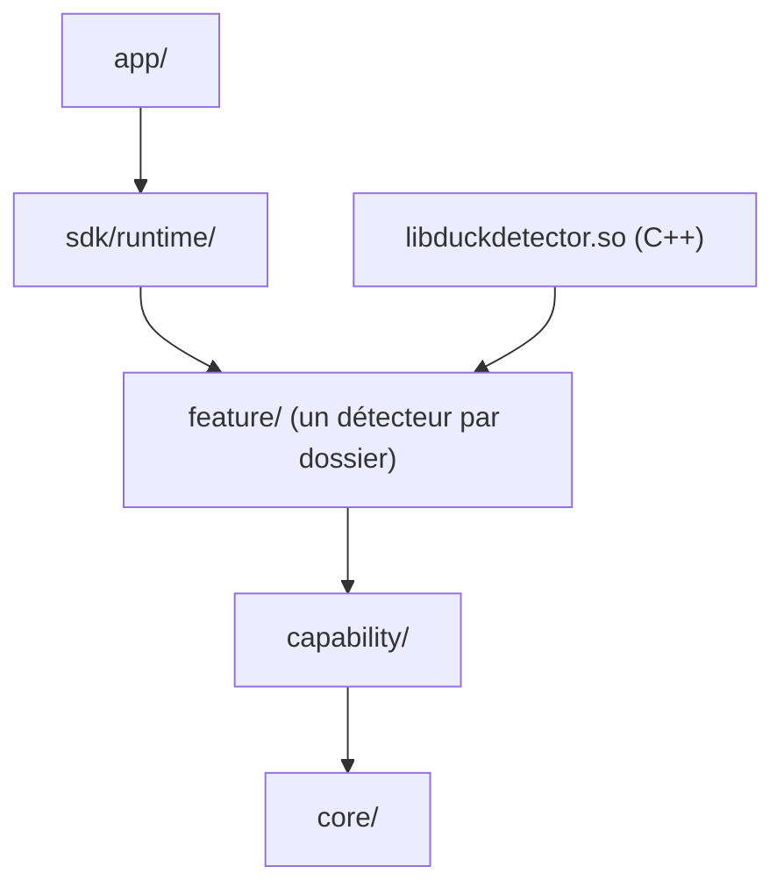

# eltavine/Duck-Detector-Refactoring

> Application Android de diagnostic qui expose les signaux d'intégrité de l'appareil, façon Momo.

## Le problème
Certaines applications traitent l'utilisateur différemment selon l'intégrité de son appareil, sans le dire clairement.

## Ce que ça fait vraiment
Collecte des preuves locales : état du bootloader, racine et SU, injection ou hooking, montages, propriétés système, KeyStore et attestation TEE, virtualisation. Chaque détecteur donne un statut (Danger, Warning, All Clear, Info). Les mêmes détecteurs sont publiés en SDK AAR sans interface. Les résultats sont heuristiques, non une preuve.

## Comment c'est branché


## Essayer
```bash
git submodule update --init --recursive
./gradlew :app:assembleDebug
./gradlew :sdk:aar:publish
```

## Coût et pièges
Gratuit, pas de root. Build lourd : Android SDK 37, NDK 30, JDK 17, CMake. Accès réseau optionnel (révocation TEE, mises à jour GitHub, éventuellement via gh-proxy.com).

## Ce que ce n'est pas
Pas un verdict de sécurité ni un contournement : l'outil observe, il ne cache rien. Pas de version stable, seulement des Nightly.

## Alternatives
Le README cite Momo comme outil comparable.

## Pour toi
À ignorer : diagnostic d'appareil Android sans lien avec un travail data, IA ou MLOps.

