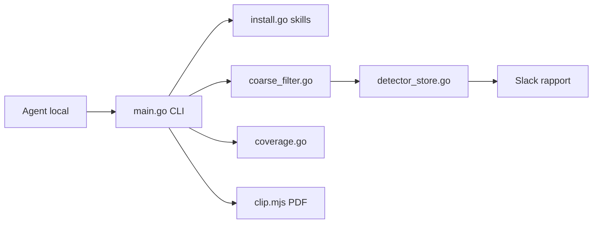

# elvisun/newsjack

> About thirty agent skills and a Go CLI for reactive PR and visibility in AI answers.

## The problem
Founders and small agencies do their public relations by hand: monitoring, angle, journalist list, proofreading. None of it chains together.

## What it actually does
Markdown instructions (skills) that the agent reads, plus a `newsjack` CLI. Four families: detect (monitoring, coarse filter, triage), act (angles, headlines, fact-check, crisis statement, PDF press-clip), strategy (calendar, newsworthiness) and "AI visibility" (seven skills that build a panel of prompts). The research or outreach skills go through Medialyst, optionally.

## How it is wired


## Trying it
```bash
curl -fsSL newsjack.sh | bash
# ou
npm i -g newsjack@latest
newsjack login
newsjack auth status
```

## Cost and gotchas
The skills marked 🔧 (news research, calendar, journalists) require a free Medialyst account. Automatic update from GitHub Releases is on by default (`NEWSJACK_AUTO_UPDATE=0` to turn it off). The README advises reading `install.sh` before the `curl | bash`.

## What it is not
Not a data science tool: it is marketing and PR. On Claude.ai, ChatGPT or Cowork, monitoring runs in a limited mode, with no state kept. `press-clip` and the setup skills require a local agent.

## Alternatives
No alternative named in the README.

## For you
Watch: only the "AI visibility" family (prompt panel, answer-leak check) touches the AI craft; the rest targets PR and depends on Medialyst.
