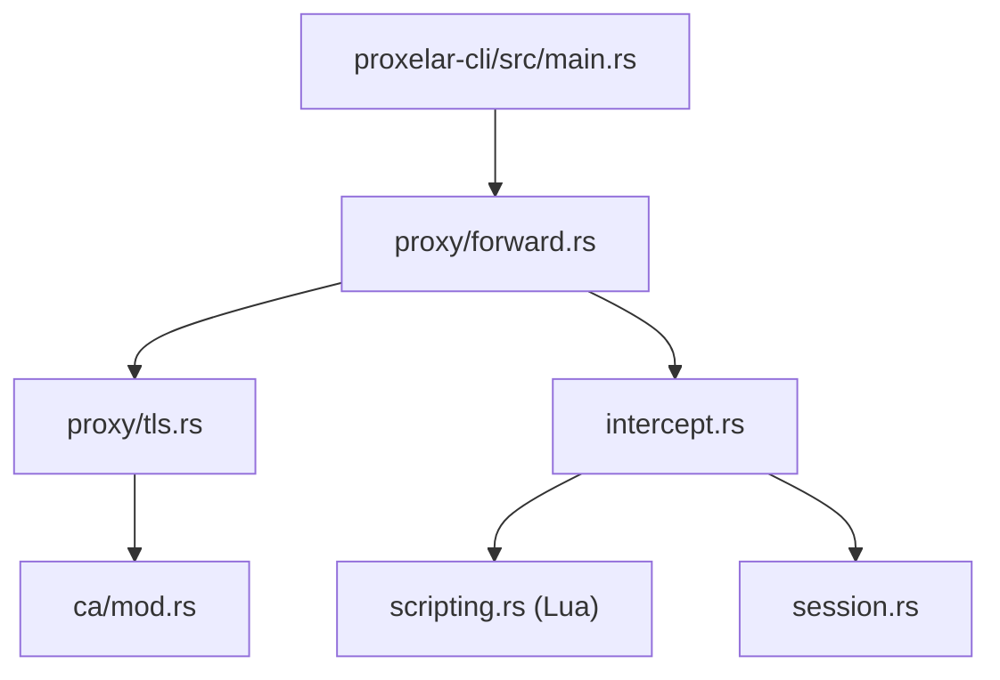

# emanuele-em/proxelar

> Single-binary Rust MITM proxy to inspect, intercept, replay and rewrite traffic during development.

## The problem
Seeing and modifying what an application exchanges over the network often requires a heavy security suite.

## What it actually does
A local proxy with four interfaces: TUI, terminal, web GUI, REST API. Interactive interception, Lua scripts (`on_request`, `on_response`), API mocks, rewrite rules, sessions exportable as HAR or curl. Forward, reverse, WireGuard, SOCKS5, DNS and UDP modes. HTTPS through a local certificate authority.

## How it is wired


## Trying it
```bash
cargo install proxelar
proxelar
curl -x http://127.0.0.1:8080 https://httpbin.org/get
proxelar -m reverse --target http://localhost:3000 --script mock_user.lua
```

## Cost and gotchas
Free. HTTPS requires trusting the local CA. Apps that pin certificates and many Android apps reject the CA.

## What it is not
Not a security suite like Burp. Not hardened for remote multi-user use. Less complete than mitmproxy.

## Alternatives
mitmproxy, for a more mature tool; Burp Suite or Caido for security testing; Charles, Proxyman or HTTP Toolkit for a desktop interface.

## For you
Watch: handy for debugging API calls to models or services, but mitmproxy remains the safe choice.
