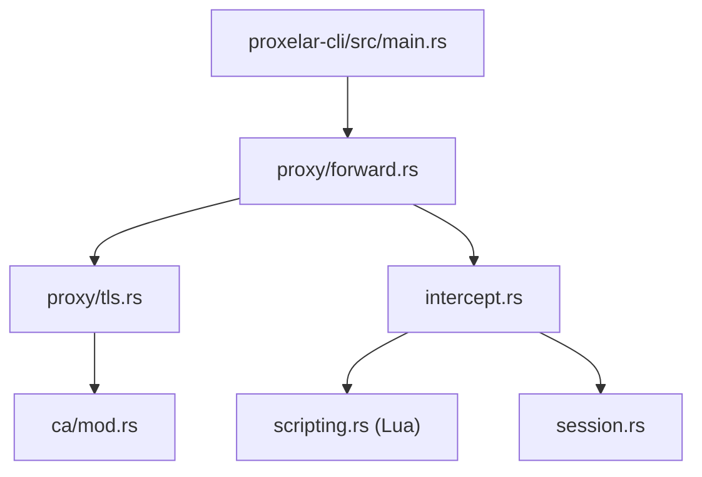

# emanuele-em/proxelar

> Proxy MITM en un binaire Rust pour inspecter, intercepter, rejouer et réécrire le trafic en développement.

## Le problème
Voir et modifier ce qu'une application échange sur le réseau exige souvent une suite de sécurité lourde.

## Ce que ça fait vraiment
Un proxy local avec quatre interfaces : TUI, terminal, GUI web, API REST. Interception interactive, scripts Lua (`on_request`, `on_response`), moqueries d'API, règles de réécriture, sessions exportables en HAR ou curl. Modes direct, inverse, WireGuard, SOCKS5, DNS et UDP. HTTPS via une autorité de certification locale.

## Comment c'est branché


## Essayer
```bash
cargo install proxelar
proxelar
curl -x http://127.0.0.1:8080 https://httpbin.org/get
proxelar -m reverse --target http://localhost:3000 --script mock_user.lua
```

## Coût et pièges
Gratuit. Le HTTPS exige de faire confiance à la CA locale. Les applis qui épinglent les certificats et beaucoup d'applis Android refusent la CA.

## Ce que ce n'est pas
Pas une suite de sécurité comme Burp. Pas durci pour un usage multi-utilisateur à distance. Moins complet que mitmproxy.

## Alternatives
mitmproxy, pour un outil plus mûr ; Burp Suite ou Caido pour des tests de sécurité ; Charles, Proxyman ou HTTP Toolkit pour une interface bureau.

## Pour toi
Surveiller : pratique pour déboguer les appels d'API vers des modèles ou services, mais mitmproxy reste la valeur sûre.

