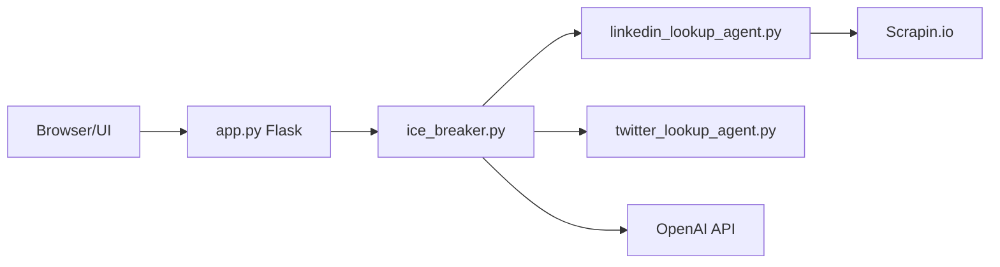

# emarco177/ice_breaker

> Course of LangChain and LangGraph projects, including the Ice Breaker application, aimed at Python developers.

## The problem
Learning to build useful LLM agents requires concrete projects, not toy examples.

## What it actually does
The README describes a course (LangChain v1) of seven projects: hello world, research agent with Tavily, reasoning/action, RAG, documentation assistant, code interpreter, reflection agents and Agentic RAG. Some are on branches, others in external repositories. The Ice Breaker application (Flask) fetches LinkedIn (Scrapin.io) and Twitter profiles then generates an opening line via OpenAI.

## How it is wired


## Trying it
```bash
git clone https://github.com/emarco177/langchain-course
cd langchain-course
git checkout project/hello-world
uv sync
uv run python main.py
```

## Cost and gotchas
Access to an LLM (OpenAI, Anthropic, Gemini or Ollama). Ice Breaker assumes Scrapin.io and the Twitter API, paid services according to the diagram. The associated course is sold separately.

## What it is not
Not a reusable library nor a course for beginners. The README announces three different content versions (7 projects, LangChain 0.3+ and v1.0): do not rely on it to the letter.

## Alternatives
No alternative named in the README.

## For you
Worth watching: a good resource for learning LangChain, but the Ice Breaker example depends on paid scraping services and its value lies in the training, not the code.
