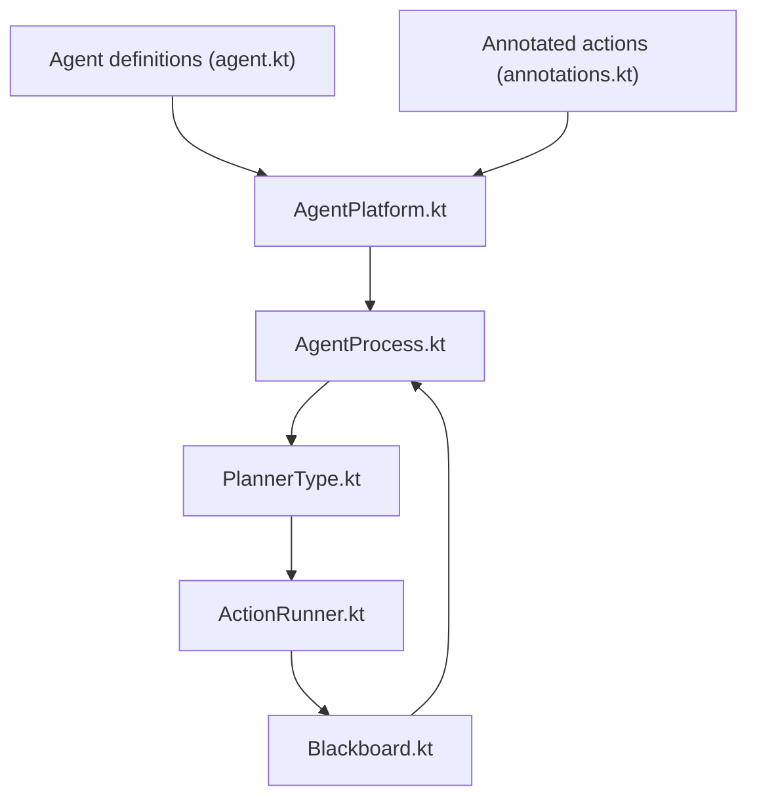

# embabel/embabel-agent

> JVM framework (Kotlin, Java, Spring) for writing agents whose plan is computed, not hard-coded.

## The problem
LLM agents with a fixed sequence or a state machine scale poorly, and flows mixing code and prompts are hard to test.

## What it actually does
You declare actions, goals and conditions on a typed domain model, via annotations (`@Agent`, `@Action`, `@AchievesGoal`) or a Kotlin DSL. A non-LLM planner (GOAP by default, or Utility AI) chooses the actions and replans after each one. Three modes: focused, closed, open. It builds on Spring AI, mixes several LLMs, offers RAG, an A2A server and unit tests for agents.

## How it is wired


## Trying it
```bash
uvx --from git+https://github.com/embabel/project-creator.git project-creator
git clone https://github.com/embabel/embabel-agent-examples
cd embabel-agent-examples/scripts/kotlin
./shell.sh
```

## Cost and gotchas
`OPENAI_API_KEY` is required, `ANTHROPIC_API_KEY` recommended: the bill is yours. Docker Desktop (version 4.43.2 or later) is used for MCP tools; Maven and a JDK are also needed, which the prerequisites list does not cover.

## What it is not
Not a Python framework. The "open" mode is the least deterministic, and the README says it is still working on natural-language actions.

## Alternatives
- Spring AI: lower level, Embabel is built on top of it.

## For you
Worth watching: the idea of explicit planning is original, but everything runs on the JVM; useful only if your stack is Spring.
