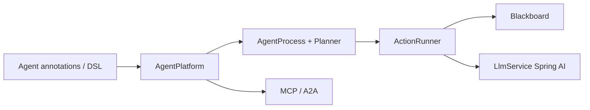

# embabel/embabel-agent

> Framework JVM typé pour écrire des agents qui planifient leurs actions vers un but, mêlant code et LLM.

## Le problème
Les agents écrits comme chaînes de prompts sont difficiles à tester, à réutiliser et à étendre, surtout dans un écosystème Spring/Java.

## Ce que ça fait vraiment
On déclare actions, buts et conditions avec des annotations `@Agent`, `@Action`, `@Goal` ou une DSL Kotlin. La plateforme planifie dynamiquement avec GOAP (ou Utility AI) et replanifie après chaque action. Trois modes d'exécution : focalisé, fermé, ouvert. Fournit mélange de LLM, serveur et client MCP, A2A, RAG, observabilité OpenTelemetry/Langfuse et tests unitaires de prompts.

## Comment c'est branché


## Essayer
```bash
uvx --from git+https://github.com/embabel/project-creator.git project-creator
git clone https://github.com/embabel/embabel-agent-examples
cd embabel-agent-examples/scripts/kotlin
./shell.sh
mvn test
```

## Coût et pièges
`OPENAI_API_KEY` requis, Anthropic recommandé pour certains exemples ; Docker Desktop pour les outils MCP web. Les appels LLM sont facturés par le fournisseur.

## Ce que ce n'est pas
Pas un framework Python ni un produit fini : une base pour développeurs JVM. Le mode ouvert est le moins déterministe.

## Alternatives
- Spring AI : couche plus bas niveau sur laquelle Embabel s'appuie.

## Pour toi
À ignorer sauf contexte JVM : l'idée de planification non-LLM est intéressante, mais pour un profil data/IA Python l'écosystème n'offre pas de gain direct.

