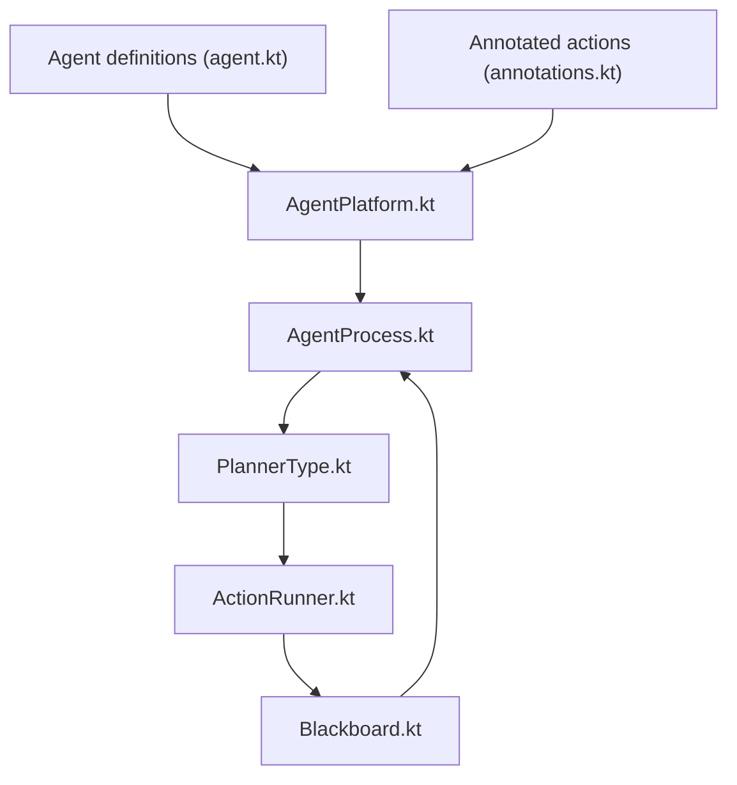

# embabel/embabel-agent

> Framework JVM (Kotlin, Java, Spring) pour écrire des agents dont le plan est calculé, pas codé en dur.

## Le problème
Les agents LLM en séquence figée ou en machine à états s'étendent mal, et les flux mêlant code et prompts sont difficiles à tester.

## Ce que ça fait vraiment
Tu déclares des actions, des objectifs et des conditions sur un modèle de domaine typé, via annotations (`@Agent`, `@Action`, `@AchievesGoal`) ou DSL Kotlin. Un planificateur non-LLM (GOAP par défaut, ou Utility AI) choisit les actions et replanifie après chacune. Trois modes : ciblé, fermé, ouvert. Il s'appuie sur Spring AI, mélange plusieurs LLM, propose du RAG, un serveur A2A et des tests unitaires d'agents.

## Comment c'est branché


## Essayer
```bash
uvx --from git+https://github.com/embabel/project-creator.git project-creator
git clone https://github.com/embabel/embabel-agent-examples
cd embabel-agent-examples/scripts/kotlin
./shell.sh
```

## Coût et pièges
`OPENAI_API_KEY` est requis, `ANTHROPIC_API_KEY` conseillé : la facture reste à ta charge. Docker Desktop (version 4.43.2 ou plus) sert aux outils MCP ; Maven et un JDK sont aussi nécessaires, ce que la liste de prérequis ne couvre pas.

## Ce que ce n'est pas
Pas un framework Python. Le mode « ouvert » est le moins déterministe, et le README dit travailler encore sur des actions en langage naturel.

## Alternatives
- Spring AI : niveau plus bas, Embabel est construit dessus.

## Pour toi
À surveiller : l'idée de planification explicite est originale, mais tout est sur la JVM ; utile seulement si ta stack est Spring.

