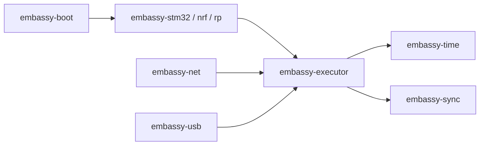

# embassy-rs/embassy

> Asynchronous Rust framework for microcontrollers, aimed at embedded systems developers.

## The problem
Writing concurrent embedded code without a classic RTOS or manual handling of hardware timers.

## What it actually does
A cooperative async executor (tasks turned into state machines, no dynamic allocation), HALs for STM32, nRF, RP2040/RP23xx, MSPM0 and others, global time (`embassy_time`), a network stack (`embassy-net`), USB, a bootloader with safe updates.

## How it is wired


## Trying it
```bash
cd examples/nrf52840
cargo run --release --bin blinky
```

## Cost and gotchas
Free, but you need a board, `probe-rs` and the right chip name in `Cargo.toml` and `.cargo/config.toml`, otherwise the program crashes. No single Cargo workspace: configure rust-analyzer.

## What it is not
Not a framework for servers or classic ML. "Faster and smaller than an RTOS" is a claim from the README.

## Alternatives
No alternative named, apart from esp-rs for Espressif chips.

## For you
Ignore, unless you have an embedded TinyML project: this is Rust electronics, far from data work or MLOps.
