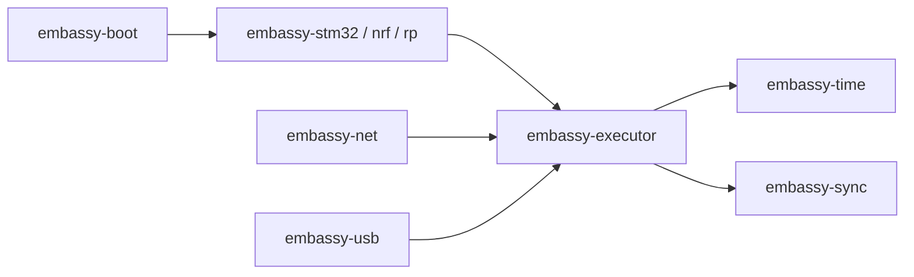

# embassy-rs/embassy

> Framework Rust asynchrone pour microcontrôleurs, destiné aux développeurs de systèmes embarqués.

## Le problème
Écrire du code embarqué concurrent sans RTOS classique ni gestion manuelle de timers matériels.

## Ce que ça fait vraiment
Un exécuteur async coopératif (tâches transformées en machines à états, sans allocation dynamique), des HAL pour STM32, nRF, RP2040/RP23xx, MSPM0 et autres, le temps global (`embassy_time`), une pile réseau (`embassy-net`), USB, bootloader avec mise à jour sûre.

## Comment c'est branché


## Essayer
```bash
cd examples/nrf52840
cargo run --release --bin blinky
```

## Coût et pièges
Gratuit, mais il faut une carte, `probe-rs` et le bon nom de puce dans `Cargo.toml` et `.cargo/config.toml`, sinon le programme plante. Pas de workspace Cargo unique : configurer rust-analyzer.

## Ce que ce n'est pas
Pas un framework pour serveurs ou ML classique. « Plus rapide et plus petit qu'un RTOS » est une affirmation du README.

## Alternatives
Aucune alternative nommée, hormis esp-rs pour les puces Espressif.

## Pour toi
À ignorer, sauf projet de TinyML embarqué : c'est de l'électronique Rust, loin d'un travail de données ou de MLOps.

