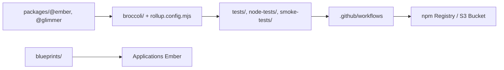

# emberjs/ember.js

> JavaScript framework for ambitious web applications, aimed at front-end teams who want strong conventions.

## The problem
Building a large web application means remaking the same choices: routing, data, structure. Ember provides conventions to avoid that.

## What it actually does
The repository is a monorepo: the framework core (`packages/@ember/*`, `@glimmer/*`), code generators (`blueprints/`), the build chain (Broccoli, Rollup, Babel), and unit, integration and smoke tests. On the usage side, the README advertises routing, a data layer, autotracking reactivity and HTML-first components. Publishing goes through scripts in `bin/` to npm and an S3 bucket.

## How it is wired

## Trying it
No command documented in the repository README (it points to the website, the guides and CONTRIBUTING.md).

## Cost and gotchas
Free, Node required. The README details neither installation nor prerequisites. Cross-browser tests go through BrowserStack (on the contributors' side).

## What it is not
It is neither a data library nor an AI tool. It is a complete framework to adopt as a whole, not a building block to graft on.

## Alternatives
No alternative cited in the README.

## For you
Ignore: a general-purpose front-end framework unrelated to data, AI or MLOps; reconsider only if a team already uses it.
