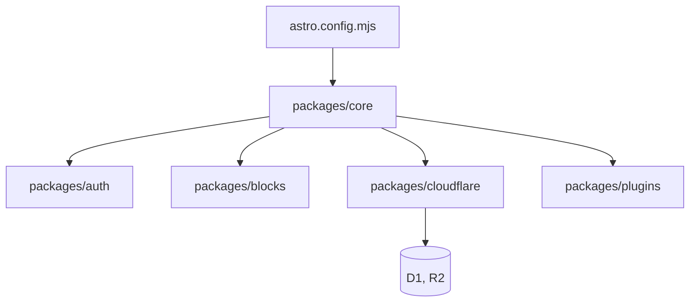

# emdash-cms/emdash

> TypeScript CMS on Astro, with sandboxed plugins, for sites deployed on Cloudflare or Node.

## The problem
WordPress mixes PHP and JavaScript and its plugins have full access to the database, which creates vulnerabilities.

## What it actually does
An Astro integration that adds an admin panel, REST API, authentication (passkey, OAuth), media library and a plugin system. Content types are defined in the database, rich text is stored as Portable Text. Plugins declare capabilities and run isolated. An MCP server and a CLI serve agents. WordPress import is possible.

## How it is wired


## Trying it
```bash
npm create emdash@latest
npx emdash types
pnpm --filter emdash-demo dev
```

## Cost and gotchas
Runs on Cloudflare (D1, R2, Workers) or Node with SQLite. Cloudflare hosting may be billed. The official plugins are still 0.x.

## What it is not
Not a data or AI tool: it is a CMS. The README calls it stable, but the repository dates from April 2026. Not a WordPress clone.

## Alternatives
No alternative named, apart from WordPress, cited as a point of comparison.

## For you
Worth watching: outside the data/AI scope, unless you build a content site with agent integration.
