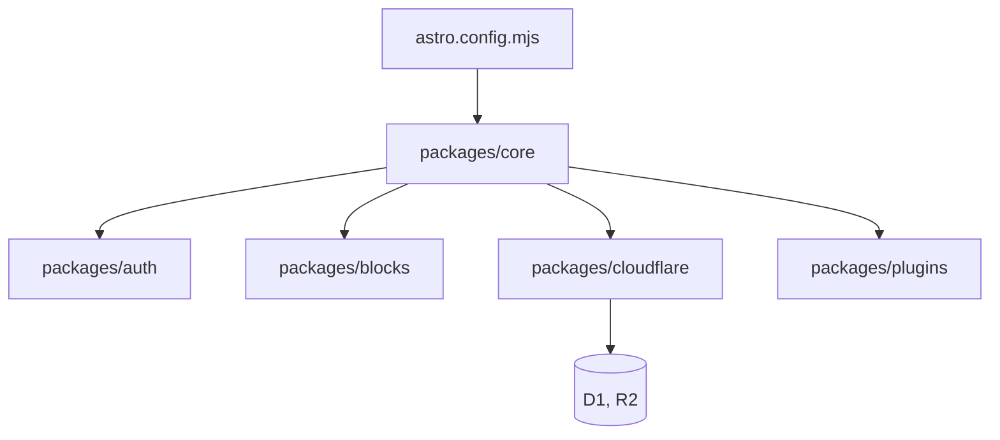

# emdash-cms/emdash

> CMS TypeScript sur Astro, avec plugins en bac à sable, pour sites déployés sur Cloudflare ou Node.

## Le problème
WordPress mélange PHP et JavaScript et ses plugins ont un accès total à la base, ce qui crée des failles.

## Ce que ça fait vraiment
Intégration Astro qui ajoute panneau d'administration, API REST, authentification (passkey, OAuth), médiathèque et système de plugins. Les types de contenu se définissent en base, le texte riche est stocké en Portable Text. Les plugins déclarent des capacités et tournent isolés. Un serveur MCP et une CLI servent aux agents. Import WordPress possible.

## Comment c'est branché


## Essayer
```bash
npm create emdash@latest
npx emdash types
pnpm --filter emdash-demo dev
```

## Coût et pièges
Fonctionne sur Cloudflare (D1, R2, Workers) ou Node avec SQLite. L'hébergement Cloudflare peut être facturé. Les plugins officiels sont encore en 0.x.

## Ce que ce n'est pas
Pas un outil data ou IA : c'est un CMS. Le README le dit stable, mais le dépôt date d'avril 2026. Pas un clone de WordPress.

## Alternatives
Aucune alternative nommée, hormis WordPress, cité comme point de comparaison.

## Pour toi
À surveiller : hors du périmètre data/IA, sauf si tu construis un site de contenu avec intégration d'agents.

