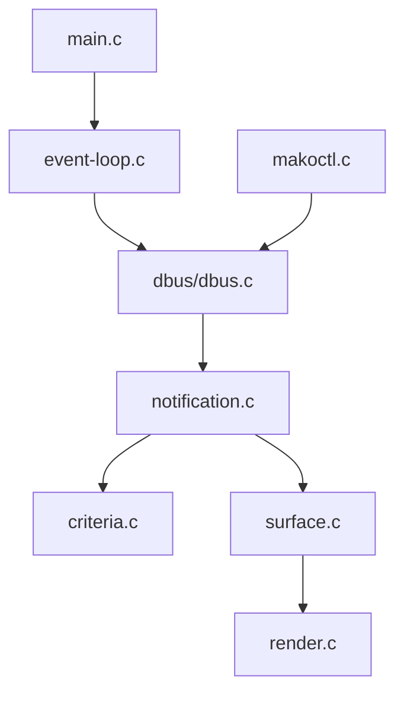

# emersion/mako

> Lightweight notification daemon for Wayland, Sway-compatible, following the FreeDesktop specification.

## The problem
Desktop notifications must be displayed under a Wayland compositor without a full desktop environment.

## What it actually does
Listens on D-Bus, applies the configuration criteria, then draws the notifications on a Wayland layer-shell surface (`render.c`). Started by D-Bus activation. `makoctl` controls it at runtime.

## How it is wired


## Trying it
```bash
meson setup build
ninja -C build
build/mako
```

## Cost and gotchas
Free. Dependencies: meson, wayland, pango, cairo, sd-bus, dbus with a user session. Configuration via `man 5 mako`.

## What it is not
Not a daemon for X11 or for every environment. Not a full notification center.

## Alternatives
No alternative cited in the README.

## For you
Ignore: Linux Wayland desktop utility, unrelated to data, AI or MLOps work.
