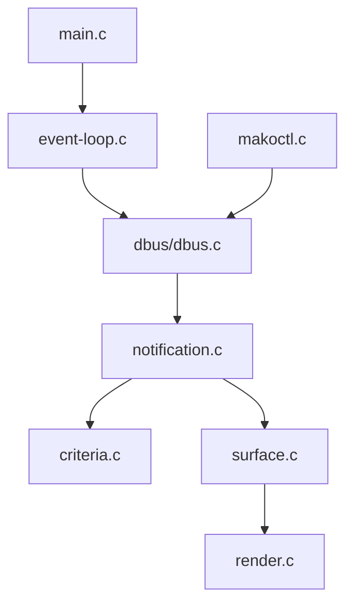

# emersion/mako

> Démon de notifications léger pour Wayland, compatible Sway, qui suit la spécification FreeDesktop.

## Le problème
Il faut afficher les notifications de bureau sous un compositeur Wayland sans environnement complet.

## Ce que ça fait vraiment
Écoute D-Bus, applique les critères de configuration, puis dessine les notifications sur une surface layer-shell Wayland (`render.c`). Lancé par activation D-Bus. `makoctl` le pilote à l'exécution.

## Comment c'est branché


## Essayer
```bash
meson setup build
ninja -C build
build/mako
```

## Coût et pièges
Gratuit. Dépendances : meson, wayland, pango, cairo, sd-bus, dbus avec session utilisateur. Configuration via `man 5 mako`.

## Ce que ce n'est pas
Pas un démon pour X11 ni pour tous les environnements. Pas un centre de notifications complet.

## Alternatives
Aucune alternative citée dans le README.

## Pour toi
Ignorer : utilitaire de bureau Linux Wayland, sans lien avec un travail data, IA ou MLOps.

