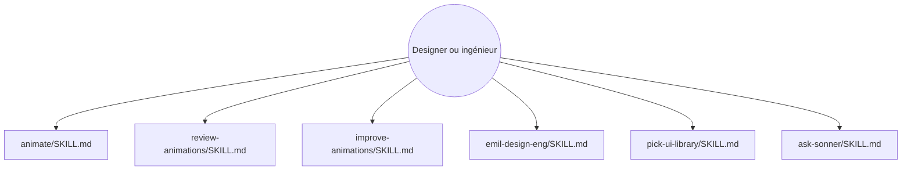

# emilkowalski/skills

> Skills for agents to design and audit animations and interfaces, developed by a designer-engineer.

## The problem
Developers make poor choices regarding animation curves and interface details, which ultimately result in a subpar visual experience.

## What it actually does
Seventeen skills in the `SKILL.md` format: creating an animation, reviewing it, auditing a codebase, identifying where to add or remove animations, choreography, correcting frame loss, Apple best practices, modern Swift, UI library selection, prototypes, native mobile on the web, UI robustness testing, and Sonner usage. No source code is provided for the graph.

## How it is wired


## Trying it
```bash
npx skills@latest add emilkowalski/skills
```

## Cost and gotchas
Free. Installation is done using `npx`. The content reflects the choices of a single person.

## What it is not
This is not an animation library; it contains instructions for the agent. It is not very useful outside of the front-end.

## Alternatives
No alternative is specified in the README file.

## For you
Focused on the user interface and animation, rather than data or MLOps: this is best suited for a future dashboard, not for immediate implementation.
