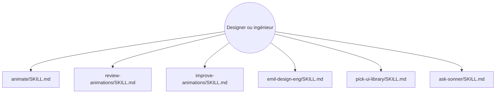

# emilkowalski/skills

> Skills d'agent pour concevoir et auditer animations et interfaces, signés d'un designer-ingénieur.

## Le problème
Les agents de code choisissent de mauvaises courbes d'animation et des détails d'interface qui s'accumulent en un rendu médiocre.

## Ce que ça fait vraiment
Dix-sept skills au format `SKILL.md` : créer une animation, la revoir, auditer une base de code, trouver où animer ou retirer des animations, chorégraphier, corriger les pertes de frames, bonnes pratiques Apple, Swift moderne, choix de bibliothèque UI, prototypes, mobile natif sur le web, tests de robustesse UI, et usage de Sonner. Aucun code source n'est fourni au graphe.

## Comment c'est branché


## Essayer
```bash
npx skills@latest add emilkowalski/skills
```

## Coût et pièges
Gratuit. L'installation passe par `npx`. Le contenu reflète les choix d'une seule personne.

## Ce que ce n'est pas
Pas une bibliothèque d'animation : ce sont des instructions pour l'agent. Peu utile hors front-end.

## Alternatives
Aucune alternative nommée dans le README.

## Pour toi
Centré sur l'UI et l'animation, loin de la data ou du MLOps : à garder pour un futur tableau de bord, pas à installer maintenant.

