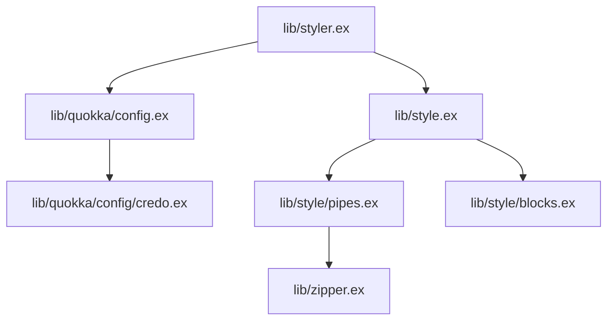

# emkguts/quokka

> Elixir formatting plugin that rewrites code according to Credo rules, a fork of Styler.

## The problem
Credo flags style problems that the developer must then fix by hand.

## What it actually does
Reads the Quokka and Credo configuration to choose the rules, then rewrites the syntax tree with a zipper (pipes, blocks, module directives, tests, numbers). Controversial rules depend on your Credo config. A "line breaks only" mode exists and plugins are possible.

## How it is wired


## Trying it
```elixir
{:quokka, "~> 2.13", only: [:dev, :test], runtime: false},
# .formatter.exs
[plugins: [Quokka]]
```

## Cost and gotchas
The README warns that Quokka can change the program's behavior: review the changes. The first run is slow.

## What it is not
Not a simple checker: it modifies files.

## Alternatives
Styler, the project it is a fork of: worth comparing if you want the original version rather than this variant. The README names no other alternative.

## For you
Ignore: useful only to Elixir teams.
