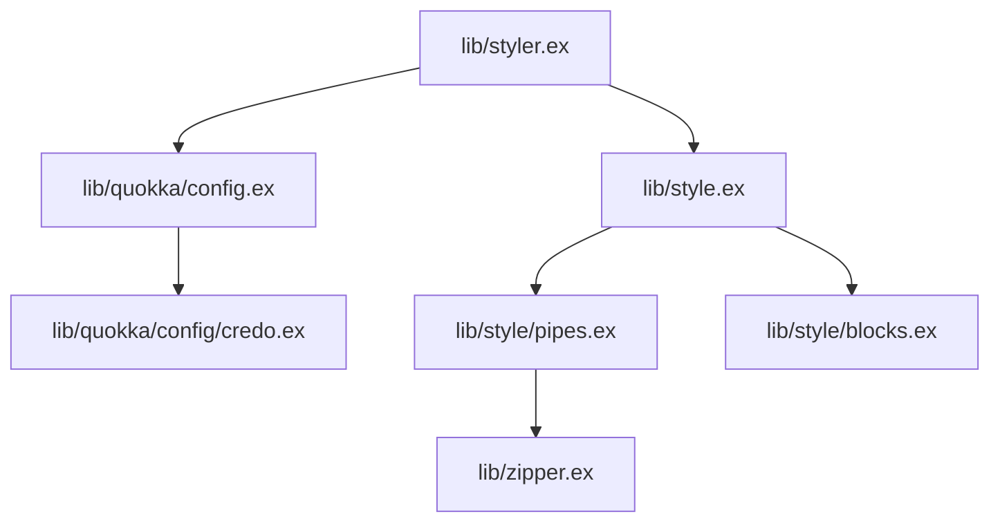

# emkguts/quokka

> Plugin Elixir de formatage qui réécrit le code selon les règles Credo, fork de Styler.

## Le problème
Credo signale des problèmes de style que le développeur doit ensuite corriger à la main.

## Ce que ça fait vraiment
Lit la configuration Quokka et Credo pour choisir les règles, puis réécrit l'arbre syntaxique avec un zipper (pipes, blocs, directives de module, tests, nombres). Les règles controversées dépendent de ta config Credo. Un mode « sauts de ligne seulement » existe et des plugins sont possibles.

## Comment c'est branché


## Essayer
```elixir
{:quokka, "~> 2.13", only: [:dev, :test], runtime: false},
# .formatter.exs
[plugins: [Quokka]]
```

## Coût et pièges
Le README avertit que Quokka peut changer le comportement du programme : relire les changements. La première exécution est lente.

## Ce que ce n'est pas
Pas un simple vérificateur : il modifie les fichiers.

## Alternatives
Styler, le projet dont il est le fork : à comparer si tu veux la version d'origine plutôt que cette variante. Le README ne nomme pas d'autre alternative.

## Pour toi
À ignorer : utile seulement aux équipes Elixir.

