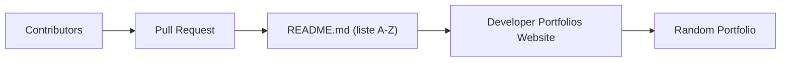

# emmabostian/developer-portfolios

> Alphabetical list of developer portfolios, for inspiration before building your own.

## The problem
Building a portfolio without concrete examples makes it hard to choose a structure or style.

## What it actually does
A README file listing 1986 portfolios sorted A to Z with, often, the title declared by the person ("Full Stack Developer", "AI Engineer"). You contribute by pull request. An associated website and a random portfolio feature exist. The content is a list of links to personal sites.

## How it is wired

## Trying it
No command; the README invites you to open a pull request to add your portfolio.

## Cost and gotchas
Free. The links point to third-party sites whose state and content no one guarantees. No license declared. Partial analysis: a portion of the README (entries B to S) could not be read in this block; most of it is a list of names.

## What it is not
It is not a portfolio template or model: it is a directory of links. The provided diagram is generic and reflects no code.

## Alternatives
- No alternative named in the README.

## For you
Ignore: a mere source of visual inspiration, with no technical value for a data/AI profile.
