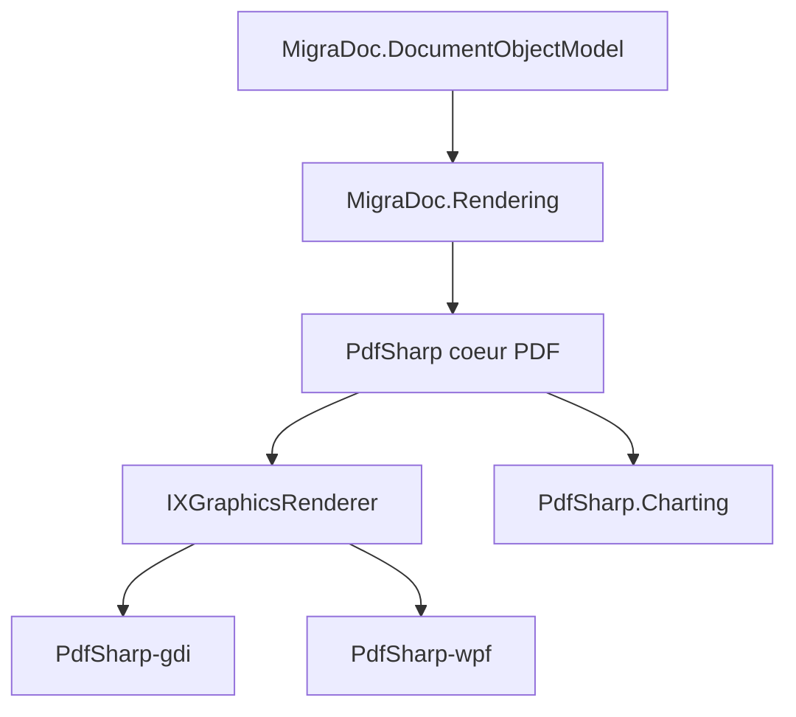

# empira/PDFsharp

> .NET library for PDF creation and document layout, with MigraDoc.

## The problem
Generating PDFs and laid-out documents from C# code without going through an external engine.

## What it actually does
Two building blocks: PDFsharp, the low-level PDF engine, and MigraDoc, a document model (sections, paragraphs, tables, charts) rendered to PDF or RTF. GDI and WPF graphics providers, plus modules for charts, barcodes, encryption, signatures and accessibility, complete the whole. Version 7.0.0 is in preview 2.

## How it is wired


## Trying it
```bash
.\dev\download-assets.ps1
dotnet build
```

## Cost and gotchas
Dual AGPL and commercial license: the AGPL constrains closed-source products. The latest .NET SDK and PowerShell 7 are required; test assets are downloaded separately.

## What it is not
Not an HTML-to-PDF converter nor a text extraction tool. Version 7 is still in preview.

## Alternatives
No alternative named in the README.

## For you
Ignore: .NET ecosystem and an awkward AGPL license, whereas Python offers several options for producing PDFs.
