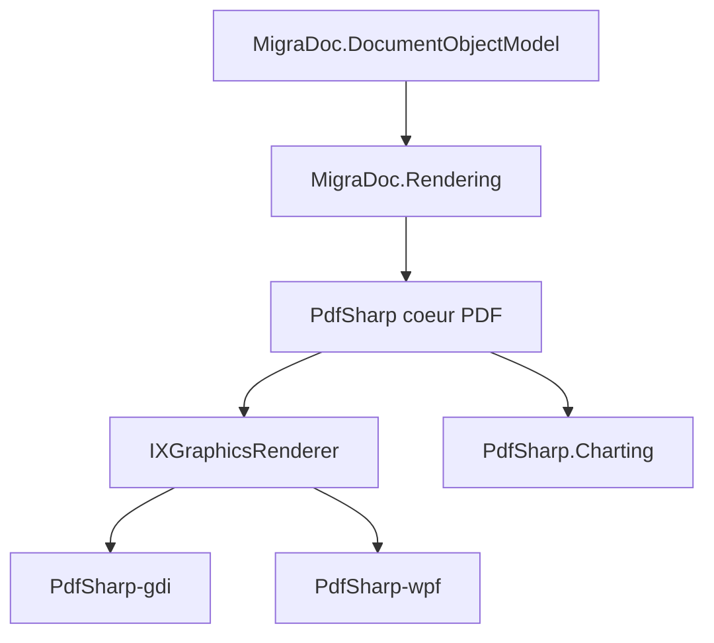

# empira/PDFsharp

> Bibliothèque .NET de création de PDF et de mise en page documentaire, avec MigraDoc.

## Le problème
Générer des PDF et des documents mis en page depuis du code C# sans passer par un moteur externe.

## Ce que ça fait vraiment
Deux briques : PDFsharp, le moteur PDF de bas niveau, et MigraDoc, un modèle de document (sections, paragraphes, tableaux, graphiques) rendu en PDF ou en RTF. Des fournisseurs graphiques GDI et WPF, des modules de graphiques, codes-barres, chiffrement, signatures et accessibilité complètent l'ensemble. La version 7.0.0 est en préversion 2.

## Comment c'est branché


## Essayer
```bash
.\dev\download-assets.ps1
dotnet build
```

## Coût et pièges
Double licence AGPL et licence commerciale : l'AGPL contraint les produits fermés. Il faut le dernier SDK .NET et PowerShell 7 ; les ressources de test se téléchargent à part.

## Ce que ce n'est pas
Pas un convertisseur HTML vers PDF ni un outil d'extraction de texte. Version 7 encore en préversion.

## Alternatives
Aucune alternative nommée dans le README.

## Pour toi
Ignorer : écosystème .NET et licence AGPL gênante, alors que Python offre plusieurs options pour produire des PDF.

