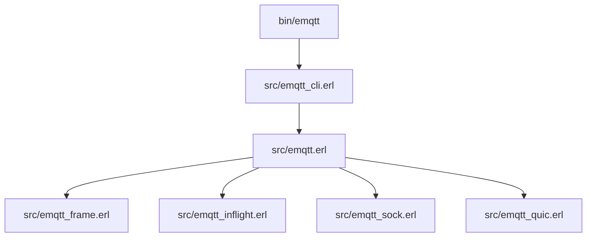

# emqx/emqtt

> MQTT client in Erlang (v5.0, 3.1.1, 3.1) with a command-line tool to publish and subscribe.

## The problem
Talking to an MQTT broker from Erlang or the terminal, including over TLS, WebSocket or QUIC.

## What it actually does
`emqtt.erl` handles the connection and in-flight messages, `emqtt_frame.erl` encodes packets, with three transports (`emqtt_sock`, `emqtt_ws`, `emqtt_quic`). The CLI `emqtt pub` publishes a message, `emqtt sub` subscribes and prints. Shared subscriptions, reconnection, MQTT v5 enhanced authentication.

## How it is wired


## Trying it
```bash
make
./emqtt pub -t "hello" --payload "hello world"
./emqtt sub -t "hello"
# bibliothèque : {deps, [{emqtt, {git, "https://github.com/emqx/emqtt", {tag, "1.14.4"}}}]}.
```

## Cost and gotchas
Needs an Erlang toolchain to build; `BUILD_WITHOUT_QUIC=1 make` if QUIC causes trouble. An MQTT broker is required. The README provided is truncated in the function list.

## What it is not
Not a broker: only an MQTT client. It connects to an existing broker and does not route messages itself.

## Alternatives
No alternative named in the README.

## For you
Watch: the `pub`/`sub` CLI helps out for testing an IoT MQTT flow; the library is only useful if you code in Erlang.
