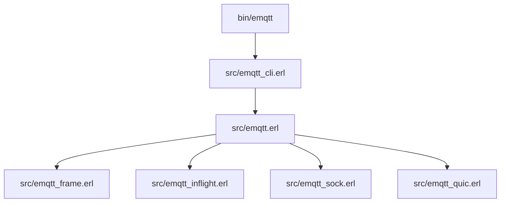

# emqx/emqtt

> Client MQTT en Erlang (v5.0, 3.1.1, 3.1) avec outil en ligne de commande pour publier et s'abonner.

## Le problème
Parler à un broker MQTT depuis Erlang ou le terminal, y compris en TLS, WebSocket ou QUIC.

## Ce que ça fait vraiment
`emqtt.erl` gère la connexion et les messages en vol, `emqtt_frame.erl` encode les paquets, trois transports (`emqtt_sock`, `emqtt_ws`, `emqtt_quic`). La CLI `emqtt pub` publie un message, `emqtt sub` s'abonne et affiche. Abonnements partagés, reconnexion, authentification renforcée MQTT v5.

## Comment c'est branché


## Essayer
```bash
make
./emqtt pub -t "hello" --payload "hello world"
./emqtt sub -t "hello"
# bibliothèque : {deps, [{emqtt, {git, "https://github.com/emqx/emqtt", {tag, "1.14.4"}}}]}.
```

## Coût et pièges
Toolchain Erlang pour compiler ; `BUILD_WITHOUT_QUIC=1 make` si QUIC pose problème. Un broker MQTT est nécessaire. Le README fourni est tronqué dans la liste des fonctions.

## Ce que ce n'est pas
Pas un broker : seulement un client MQTT. Il se connecte à un broker existant, il ne route pas les messages lui-même.

## Alternatives
Aucune alternative nommée dans le README.

## Pour toi
Surveiller : la CLI `pub`/`sub` dépanne pour tester un flux MQTT IoT ; la bibliothèque ne sert que si tu codes en Erlang.

