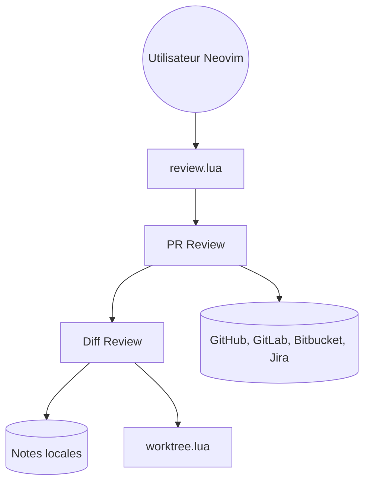

# emrearmagan/atlas.nvim

> Neovim plugin to review pull requests and manage GitHub, GitLab, Bitbucket and Jira tickets from the editor.

## The problem
Reviewing PRs and tracking tickets forces you to leave the editor for several websites.

## What it actually does
`:Atlas review` opens a PR in a diff viewer (CodeDiff, Diffview or AtlasDiff) with comments, local notes, tasks and merging. The plugin also browses tickets, CI pipelines and repositories, and creates PRs. A temporary worktree lets language servers work on the new version. The README warns of breaking changes.

## How it is wired


## Trying it
```lua
{
  "emrearmagan/atlas.nvim",
  opts = {},
}
```
```text
:checkhealth atlas
:Atlas review
```

## Cost and gotchas
Free. It requires Neovim 0.10+, `git`, `curl`, and depending on the service an authenticated `gh`, a GitLab token (`api` scope), Bitbucket or Jira. The Diffview integrations rely on internals and may break.

## What it is not
It is not stable ("early development") nor usable without Neovim. It is not a data science tool.

## Alternatives
- diffview.nvim and codediff.nvim: diff viewers supported as options.

## For you
Worth watching if you live in Neovim and review ML pipeline PRs; still experimental, not to be adopted as is.
