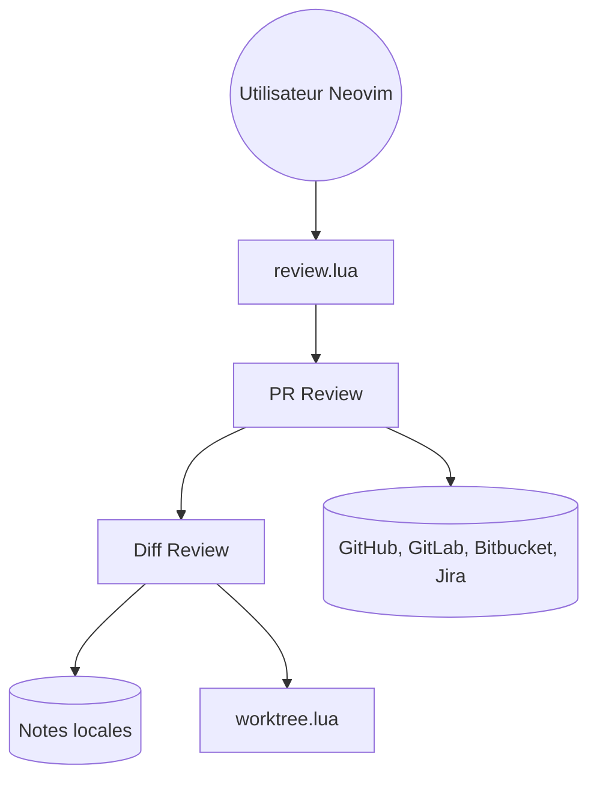

# emrearmagan/atlas.nvim

> Plugin Neovim pour relire des pull requests et gérer des tickets GitHub, GitLab, Bitbucket et Jira depuis l'éditeur.

## Le problème
Relire des PR et suivre des tickets oblige à quitter l'éditeur pour plusieurs sites web.

## Ce que ça fait vraiment
`:Atlas review` ouvre une PR dans un visualiseur de diff (CodeDiff, Diffview ou AtlasDiff) avec commentaires, notes locales, tâches et fusion. Le plugin parcourt aussi tickets, pipelines CI et dépôts, et crée des PR. Un worktree temporaire permet d'utiliser les serveurs de langage sur la nouvelle version. Le README prévient de changements incompatibles.

## Comment c'est branché


## Essayer
```lua
{
  "emrearmagan/atlas.nvim",
  opts = {},
}
```
```text
:checkhealth atlas
:Atlas review
```

## Coût et pièges
Gratuit. Il faut Neovim 0.10+, `git`, `curl`, et selon le service `gh` authentifié, un jeton GitLab (portée `api`), Bitbucket ou Jira. Les intégrations de Diffview s'appuient sur des éléments internes et peuvent casser.

## Ce que ce n'est pas
Ce n'est pas stable (« early development ») ni utilisable sans Neovim. Ce n'est pas un outil de data science.

## Alternatives
- diffview.nvim et codediff.nvim : visualiseurs de diff supportés en option.

## Pour toi
À surveiller si tu vis dans Neovim et relis des PR de pipelines ML ; encore expérimental, pas à adopter tel quel.

