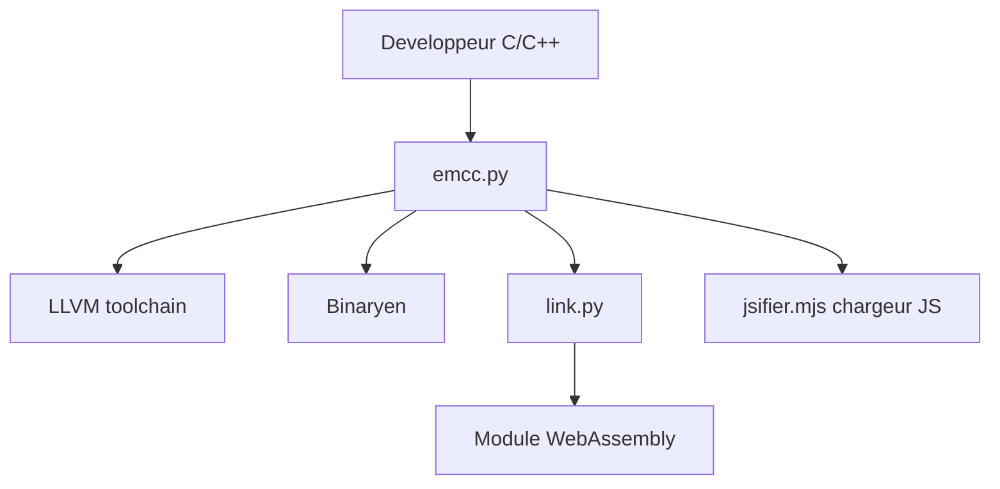

# emscripten-core/emscripten

> Compilation toolchain from C and C++ to WebAssembly, for developers porting native code to the web.

## The problem
Existing C/C++ code does not run in a browser or under Node.js without a rewrite.

## What it actually does
`emcc` is used like gcc or clang, relies on LLVM and Binaryen, and produces a WebAssembly module with a JavaScript loader. It offers compatibility libraries (OpenGL/WebGL, SDL2) and a sample HTML page served with `emrun`. The result runs in the browser, Node.js, Deno or Bun.

## How it is wired



## Trying it
```bash
./bootstrap.py
emcc hello.c -o hello.js
node hello.js
emcc hello.c -o hello.html
```

## Cost and gotchas
Free. The recommended route is the emsdk SDK. A license is present but not identified by GitHub: check it before any commercial use. More than 2,500 open issues.

## What it is not
It is not a Wasm runtime or a Python tool. It does not port any codebase by itself: the README only says it "can probably" port yours.

## Alternatives
No alternative named in the README, which only mentions Rust integration via the `wasm32-unknown-emscripten` target.

## For you
Watch: useful for running a C/C++ inference or processing library in a browser; outside that need, of no interest.
