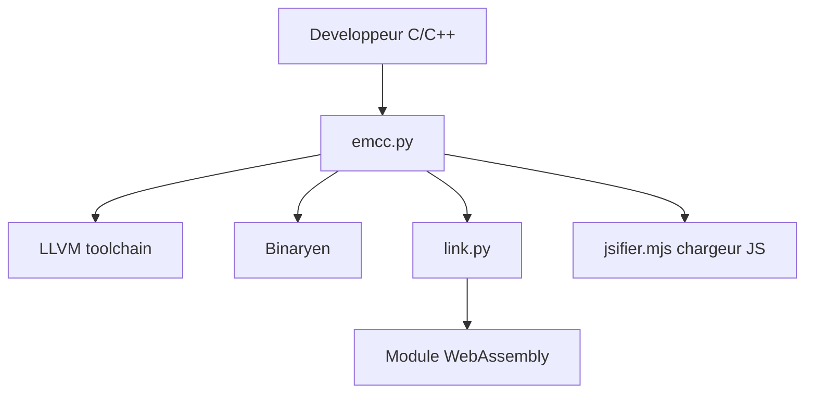

# emscripten-core/emscripten

> Chaîne de compilation de C et C++ vers WebAssembly, pour développeurs qui portent du code natif sur le web.

## Le problème
Du code C/C++ existant ne tourne pas dans un navigateur ni sous Node.js sans réécriture.

## Ce que ça fait vraiment
`emcc` s'utilise comme gcc ou clang, s'appuie sur LLVM et Binaryen, et produit un module WebAssembly avec un chargeur JavaScript. Il offre des bibliothèques de compatibilité (OpenGL/WebGL, SDL2) et une page HTML d'exemple servie avec `emrun`. Le résultat tourne dans le navigateur, Node.js, Deno ou Bun.

## Comment c'est branché



## Essayer
```bash
./bootstrap.py
emcc hello.c -o hello.js
node hello.js
emcc hello.c -o hello.html
```

## Coût et pièges
Gratuit. La voie recommandée est le SDK emsdk. Une licence est présente mais non identifiée par GitHub : à vérifier avant tout usage commercial. Plus de 2 500 issues ouvertes.

## Ce que ce n'est pas
Ce n'est pas un moteur d'exécution Wasm ni un outil Python. Il ne porte pas tout seul n'importe quelle base de code : le README dit seulement qu'il « peut probablement » porter la tienne.

## Alternatives
Aucune alternative nommée dans le README, qui mentionne seulement l'intégration de Rust via la cible `wasm32-unknown-emscripten`.

## Pour toi
À surveiller : utile pour exécuter une bibliothèque C/C++ d'inférence ou de traitement dans un navigateur ; hors de ce besoin, sans intérêt.

