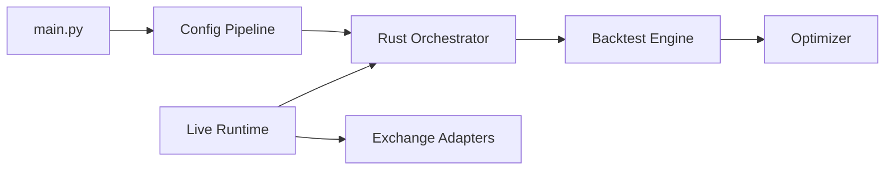

# enarjord/passivbot

> Crypto perpetual-futures trading bot, a contrarian market maker, with backtesting and an optimizer.

## The problem
Placing and cancelling limit orders continuously on derivatives markets without manual intervention.

## What it actually does
A shared Rust orchestrator computes orders in live and in backtest. Default strategy `trailing_martingale` (small entry, adds against the price, closes with a margin or trailing), `ema_anchor`, market selection (Forager) and a position-unstucking mechanism. An evolutionary optimizer iterates thousands of backtests. Exchanges cited: Bybit, OKX, Bitget, Binance, Hyperliquid and others.

## How it is wired


## Trying it
```bash
git clone https://github.com/enarjord/passivbot.git
cd passivbot
python3 -m pip install -e .
cp api-keys.json.example api-keys.json
passivbot live -u {account_name_from_api-keys.json}
```

## Cost and gotchas
Free, but capital and exchange API keys are at your expense. Python 3.12 or 3.14 (not 3.13), Rust required. v8 breaks v7 configs. The README contains referral links.

## What it is not
Not a guarantee of profit: "use at your own risk". Does not predict prices.

## Alternatives
The README cites a graphical interface, `msei99/pbgui`.

## For you
Worth watching for its backtesting and evolutionary optimization engine, but it is trading with real money: out of scope, financial risk.
