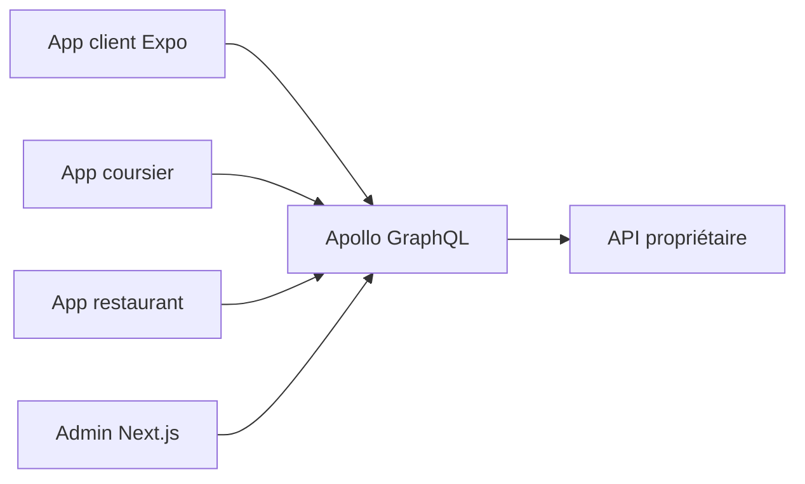

# enatega/food-delivery-multivendor

> Multi-vendor ordering and delivery suite: customer, courier, restaurant, web and admin apps.

## The problem
Launching a delivery platform (meals, groceries, pharmacy) without building everything: three mobile apps, a website and a back office.

## What it actually does
React Native (Expo) clients, a customer website, a Next.js dashboard, all connected to a GraphQL API. Courier tracking, notifications, PayPal and Stripe payments, themes and languages. Amplitude and Sentry handle analytics and error tracking. The README states that the backend and the API are proprietary.

## How it is wired


## Trying it
```bash
cd enatega-multivendor-admin && nvm use && npm install && cp .env.example .env.local && npm run dev
cd enatega-multivendor-app && npm install && npx expo start -c
```

## Cost and gotchas
The API and backend are under a paid license, outside this repository (the guide points to `../enatega-multivendor-api`). You need to create Firebase, Google, Facebook, Mongo, email and Amplitude credentials. Node 18 to 20 according to the README.

## What it is not
It is not a complete open-source solution despite the catalog's MIT license: without the paid backend, nothing runs end to end.

## Alternatives
No alternative named in the README.

## For you
Ignore: a delivery product whose core is paid and closed, unrelated to a data or MLOps profile.
