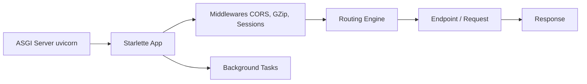

# encode/starlette

> Lightweight ASGI framework for asynchronous web services in Python, usable on its own or as a toolkit.

## The problem
Serving asynchronous APIs in Python calls for a simple ASGI layer, without heavy dependencies.

## What it actually does
HTTP routing, WebSockets, background tasks, startup and shutdown events, streaming responses, sessions and cookies. CORS, GZip, HTTPS redirect and trusted-host middlewares. Test client based on `httpx2`. Only required dependency: `anyio`; Jinja2, python-multipart, itsdangerous and pyyaml are optional. Works with asyncio and trio.

## How it is wired


## Trying it
```bash
pip install starlette
pip install uvicorn
uvicorn main:app
```

## Cost and gotchas
Free; you need a separate ASGI server such as uvicorn. The README points to starlette.dev for the documentation and to Kludex/starlette for the code, which suggests the repository has moved.

## What it is not
Not an "all-inclusive" framework: no built-in ORM or data validation.

## Alternatives
No alternative cited in the README (ASGI server implementations other than uvicorn are mentioned).

## For you
Adopt: foundation of many Python inference services, lightweight, typed and under BSD-3-Clause.
