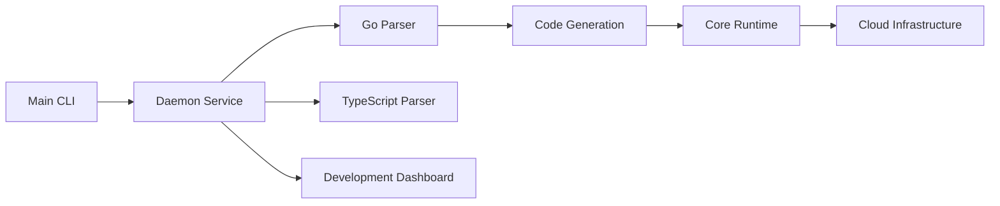

# encoredev/encore

> Go/TypeScript SDK that declares infrastructure in code and provisions it locally, then on AWS/GCP.

## The problem
Writing the code, then the Terraform, then standing up the equivalent local infrastructure creates gaps between dev and prod.

## What it actually does
You declare SQL databases, Pub/Sub, buckets, cache, cron, secrets in code; `encore run` launches local Postgres, NSQ, Redis with tracing and a dashboard (`localhost:9400`).
An application graph is compared to the environment and provisions RDS/SQS/S3 or Cloud SQL/Pub/Sub in your account.
Optional platform: per-PR preview environments, IAM derived from the code.
`encore build docker` to self-host; MCP server for agents.

## How it is wired


## Trying it
```bash
curl -L https://encore.dev/install.sh | bash
encore app create
cd myapp
encore run
```

## Cost and gotchas
The MPL-2.0 SDK is free; the managed platform is paid (see pricing) and automatic provisioning targets AWS/GCP only.
Python "coming soon": unusable for a Python backend today.

## What it is not
Not a general-purpose IaC: it covers common resources, the rest remains on you.
No Azure support for automatic provisioning.

## Alternatives
- Pulumi / CDK / Terraform / SST: IaC separate from the code, more control.
- Convex / Supabase / Firebase: managed backend, but not in your cloud account.
- Render / Fly.io / Railway / Vercel: simpler PaaS, runtime not under your control.

## For you
Worth watching for the day the Python SDK ships: today Go/TypeScript only, so outside your data stack.
