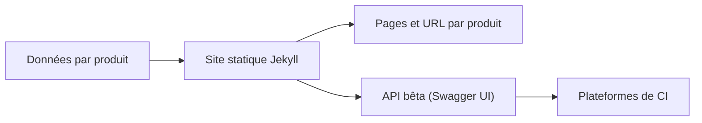

# endoflife-date/endoflife.date

> Site and API listing the end-of-life and support dates of many software products.

## The problem
These dates are hard to find or poorly presented, which causes missed migrations.

## What it actually does
Gathers end-of-support dates per product, with easy-to-guess URLs. An API (in beta, breaking changes possible) allows integrating it into CI platforms. The site is static, built with Jekyll.

## How it is wired
Simplified diagram based on the README, no diagram provided.



## Trying it
```bash
# non documenté dans le README : l'usage se fait via le site et l'API en ligne
```

## Cost and gotchas
Free. The API is in beta. The descriptions are adapted from Wikipedia (CC BY-SA 3.0), to be credited.

## What it is not
Not a vulnerability scanner nor an upgrade tool: it only informs about dates.

## Alternatives
- None cited in the README.

## For you
Watch: handy for checking support for your Python or database versions in CI, provided you accept a beta API.
