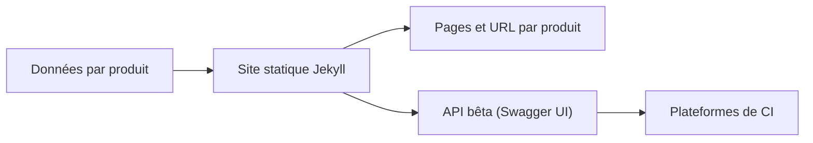

# endoflife-date/endoflife.date

> Site et API qui recensent les dates de fin de vie et de support de nombreux produits logiciels.

## Le problème
Ces dates sont difficiles à trouver ou mal présentées, ce qui fait manquer les migrations.

## Ce que ça fait vraiment
Rassemble les dates de fin de support par produit, avec des URL faciles à deviner. Une API (en bêta, changements incompatibles possibles) permet de l'intégrer aux plateformes de CI. Le site est statique, construit avec Jekyll.

## Comment c'est branché
Schéma simplifié d'après le README, sans diagramme fourni.



## Essayer
```bash
# non documenté dans le README : l'usage se fait via le site et l'API en ligne
```

## Coût et pièges
Gratuit. L'API est en bêta. Les descriptions sont adaptées de Wikipédia (CC BY-SA 3.0), à créditer.

## Ce que ce n'est pas
Pas un scanner de vulnérabilités ni un outil de mise à niveau : il informe seulement des dates.

## Alternatives
- Aucune citée dans le README.

## Pour toi
À surveiller : pratique pour vérifier le support de tes versions de Python ou de bases de données en CI, à condition d'accepter une API bêta.

