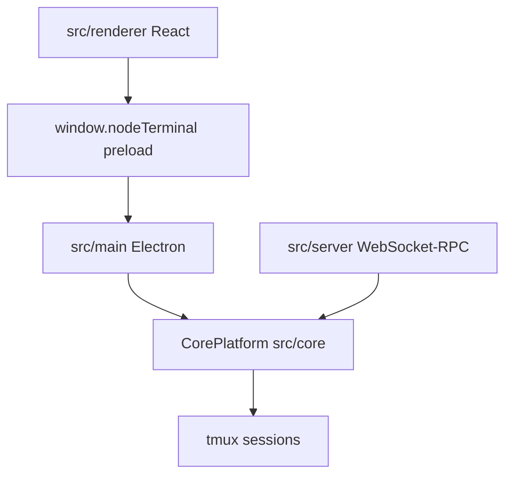

# eneskirca/nodeterm

> Node-based terminal manager on an infinite canvas, with AI agents and a session kanban board.

## The problem
Stacked terminal tabs hide what is running where, especially with several AI agents in parallel.

## What it actually does
Each terminal, agent (Claude Code, Codex, Gemini, Copilot...), note, Monaco editor or diff is a node on a canvas. Sessions survive restarts thanks to tmux. RUNNING / NEEDS YOU badges, a session kanban board, remote projects over SSH, an iOS app, local Whisper dictation and a Server Edition in the browser.

## How it is wired


## Trying it
```bash
npm install
npm run dev
npm run server:dev
brew install --cask nodeterm
```

## Cost and gotchas
Free. The connected agents have their own costs. The Windows installer is in beta and unsigned. The server install script is run with `curl ... | bash`. A license is present but unidentified: to be checked.

## What it is not
Not an agent itself: it hosts third-party agents. On macOS, Node 20+ and macOS 12 minimum to build.

## Alternatives
No alternative named in the README.

## For you
Watch: interesting if you drive several coding agents in parallel, but the license needs to be clarified.
