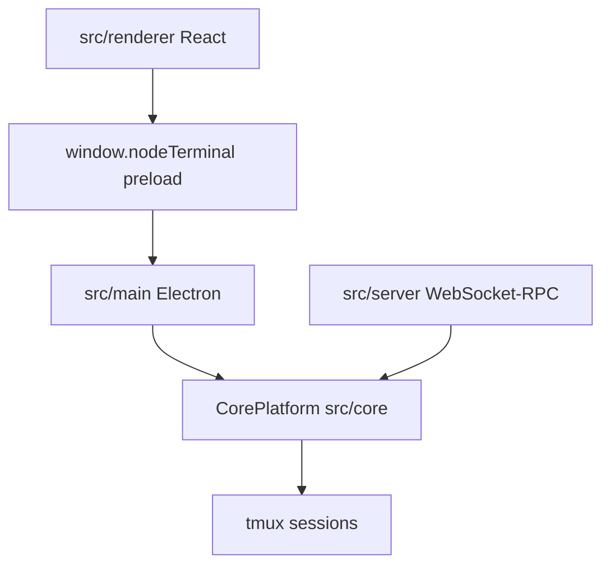

# eneskirca/nodeterm

> Gestionnaire de terminaux en nœuds sur canevas infini, avec agents IA et tableau kanban de sessions.

## Le problème
Des onglets de terminaux empilés cachent ce qui tourne où, surtout avec plusieurs agents IA en parallèle.

## Ce que ça fait vraiment
Chaque terminal, agent (Claude Code, Codex, Gemini, Copilot...), note, éditeur Monaco ou diff est un nœud sur un canevas. Les sessions survivent aux redémarrages grâce à tmux. Badges RUNNING / NEEDS YOU, tableau kanban des sessions, projets distants par SSH, appli iOS, dictée Whisper locale et Server Edition dans le navigateur.

## Comment c'est branché


## Essayer
```bash
npm install
npm run dev
npm run server:dev
brew install --cask nodeterm
```

## Coût et pièges
Gratuit. Les agents branchés ont leurs propres coûts. L'installeur Windows est en bêta et non signé. Le script d'installation serveur se lance par `curl ... | bash`. Licence présente mais non identifiée : à vérifier.

## Ce que ce n'est pas
Pas un agent lui-même : il héberge des agents tiers. Sous macOS, Node 20+ et macOS 12 minimum pour compiler.

## Alternatives
Aucune alternative nommée dans le README.

## Pour toi
À surveiller : intéressant si tu pilotes plusieurs agents de code en parallèle, mais la licence doit être clarifiée.

