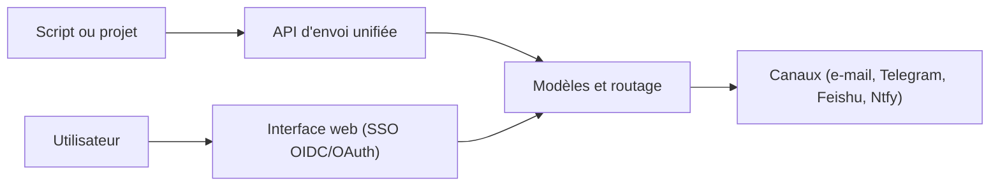

# engigu/Message-Push-Nest

> Self-hosted platform that unifies sending notifications to many channels through a single API.

## The problem
Every script that sends notifications must reimplement the call to email, Telegram, DingTalk or others, with the same code copied everywhere.

## What it actually does
Message Nest offers a single sending API and routes to email, DingTalk, WeCom, Feishu, Telegram, Bark, PushMe, Gotify or Ntfy. You define message templates with variables and routing rules. SSO login through OIDC or OAuth 2.0 (GitHub, GitLab), built-in lightweight captcha, PostgreSQL supported. The README is in Chinese; logs are not written to a file.

## How it is wired
Simplified diagram based on the sheet, no diagram provided.

## Trying it
The README gives no installation command: it points to the external documentation and to a demo site.

## Cost and gotchas
Free, self-hosted; each channel requires its own credentials. The Apache-2.0 license comes with a NOTICE file that requires crediting the author (engigu) and the original repository for any use or redistribution: read it before reusing.

## What it is not
It is not a messaging service: it relays to existing channels. It does not write log files, only console output.

## Alternatives
No alternative named in the README (it only cites another project by the author, baihu, for scheduled tasks).

## For you
Worth watching: handy for wiring pipeline alerts to Telegram or Ntfy, but the README is in Chinese and the attribution clause needs checking.
