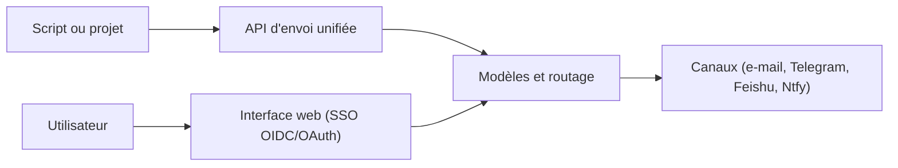

# engigu/Message-Push-Nest

> Plateforme auto-hébergée qui unifie l'envoi de notifications vers de nombreux canaux via une seule API.

## Le problème
Chaque script qui notifie doit réimplémenter l'appel à e-mail, Telegram, DingTalk ou autres, avec le même code recopié partout.

## Ce que ça fait vraiment
Message Nest propose une API d'envoi unique et route vers e-mail, DingTalk, WeCom, Feishu, Telegram, Bark, PushMe, Gotify ou Ntfy. On définit des modèles de message avec variables et des règles de routage. Connexion SSO via OIDC ou OAuth 2.0 (GitHub, GitLab), captcha léger intégré, PostgreSQL pris en charge. Le README est en chinois ; les journaux ne sont pas écrits en fichier.

## Comment c'est branché
Schéma simplifié d'après la fiche, sans diagramme fourni.

## Essayer
Le README ne donne aucune commande d'installation : il renvoie à la documentation externe et à un site de démonstration.

## Coût et pièges
Gratuit, auto-hébergé ; chaque canal exige ses propres identifiants. L'Apache-2.0 est assorti d'un fichier NOTICE qui impose de citer l'auteur (engigu) et le dépôt d'origine pour tout usage ou redistribution : à lire avant de réutiliser.

## Ce que ce n'est pas
Ce n'est pas un service de messagerie : il relaie vers des canaux existants. Il n'écrit pas de fichiers de log, seulement la sortie console.

## Alternatives
Aucune alternative nommée dans le README (il cite seulement un autre projet de l'auteur, baihu, pour les tâches planifiées).

## Pour toi
À surveiller : pratique pour brancher des alertes de pipelines vers Telegram ou Ntfy, mais README en chinois et clause d'attribution à vérifier.

