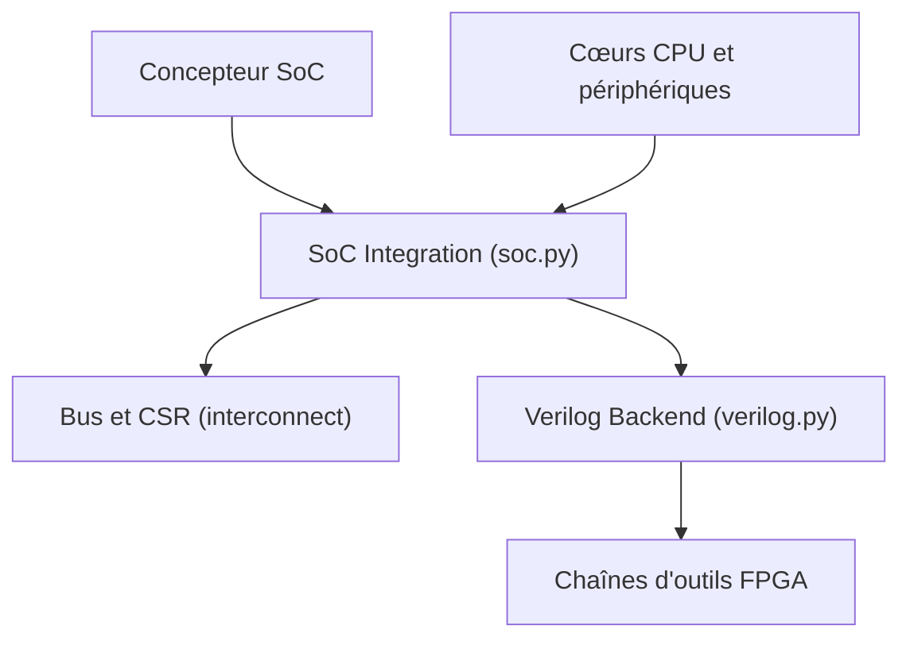

# enjoy-digital/litex

> Python framework for assembling FPGA cores and systems on chip, for hardware designers.

## The problem
Building an FPGA SoC by hand requires wiring up CPU, buses, memories and peripherals in Verilog, with a different toolchain for each vendor.

## What it actually does
You write two Python files: the platform (board, pins, clocks) and the target (CPU, memories, peripherals). LiteX generates the Verilog and the constraints, runs the toolchain or Verilator, and produces the BIOS and the software files (csr.h, device trees). Host tools (litex_term, litex_server) control the SoC over UART, JTAG, Ethernet or PCIe. An MCP server and an AGENTS.md file are provided for agents.

## How it is wired


## Trying it
```bash
python3 -m venv ~/litex-venv && source ~/litex-venv/bin/activate
wget https://raw.githubusercontent.com/enjoy-digital/litex/master/litex_setup.py
chmod +x litex_setup.py
./litex_setup.py --init --install --config=standard
./litex_setup.py --gcc=riscv
pip3 install meson ninja
litex_sim --cpu-type=vexriscv
```

## Cost and gotchas
Free. For a real board, you need the FPGA board and the vendor's toolchain. The catalog does not recognize the license; the README states BSD 2-Clause, to be confirmed.

## What it is not
It is not an AI or data tool. Simulations run without a board, but a useful result assumes hardware.

## Alternatives
No alternative named in the README.

## For you
Ignore: FPGA design, unrelated to a data / AI / MLOps profile, except for a custom hardware accelerator.
