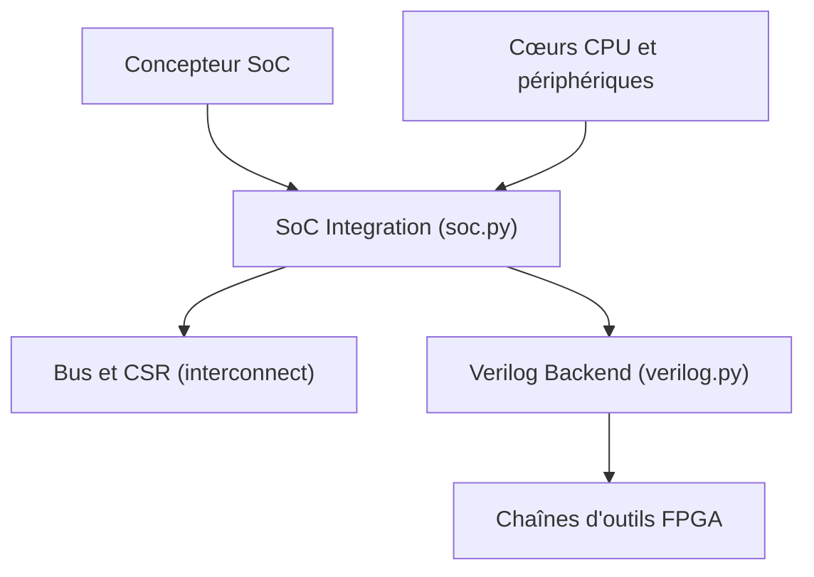

# enjoy-digital/litex

> Framework Python pour assembler des cœurs et des systèmes sur puce FPGA, pour concepteurs matériel.

## Le problème
Construire un SoC FPGA à la main demande de relier CPU, bus, mémoires et périphériques en Verilog, avec une chaîne d'outils par fabricant.

## Ce que ça fait vraiment
On écrit deux fichiers Python : la plateforme (carte, broches, horloges) et la cible (CPU, mémoires, périphériques). LiteX génère le Verilog et les contraintes, lance la chaîne d'outils ou Verilator, et produit le BIOS et les fichiers logiciels (csr.h, device trees). Des outils hôte (litex_term, litex_server) contrôlent le SoC par UART, JTAG, Ethernet ou PCIe. Un serveur MCP et un fichier AGENTS.md sont prévus pour les agents.

## Comment c'est branché


## Essayer
```bash
python3 -m venv ~/litex-venv && source ~/litex-venv/bin/activate
wget https://raw.githubusercontent.com/enjoy-digital/litex/master/litex_setup.py
chmod +x litex_setup.py
./litex_setup.py --init --install --config=standard
./litex_setup.py --gcc=riscv
pip3 install meson ninja
litex_sim --cpu-type=vexriscv
```

## Coût et pièges
Gratuit. Pour une carte réelle, il faut la carte FPGA et la chaîne d'outils du fabricant. Le catalogue ne reconnaît pas la licence ; le README annonce BSD 2-Clause, à confirmer.

## Ce que ce n'est pas
Ce n'est pas un outil d'IA ni de données. Les simulations tournent sans carte, mais le résultat utile suppose du matériel.

## Alternatives
Aucune alternative nommée dans le README.

## Pour toi
Ignorer : du design FPGA, sans lien avec un profil data / IA / MLOps, sauf accélérateur matériel sur mesure.

