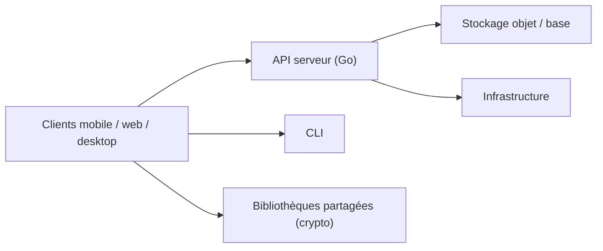

# ente-io/ente

> Monorepo of an end-to-end encrypted platform: photos, 2FA authenticator and document vault.

## The problem
Storing photos, 2FA codes and documents in the cloud forces you to trust the provider.

## What it actually does
Three applications (Photos, Auth, Locker) on a common server written in Go, with iOS, Android, web, desktop and CLI clients. Encryption is end-to-end, and according to the README the code was audited by Cure53, Symbolic Software and Fallible. Photos offers face recognition and semantic search; Auth is free; Locker is free up to 100 items. The server can be self-hosted.

## How it is wired

## Trying it
No command in the README: see ente.com and the documentation for self-hosting.

## Cost and gotchas
Photos is paid (10 GB free). Self-hosting means managing the server and storage yourself. AGPL-3.0 license.

## What it is not
Not a simple tool: it is a complete platform, and the managed service is a commercial offer. See also `ente/ente`, same README.

## Alternatives
No alternative named in the README (it cites Apple, Google Photos and Authy as products to replace).

## For you
Worth watching: interesting if you want to host your photos and 2FA encrypted, but outside your core data / MLOps work.
