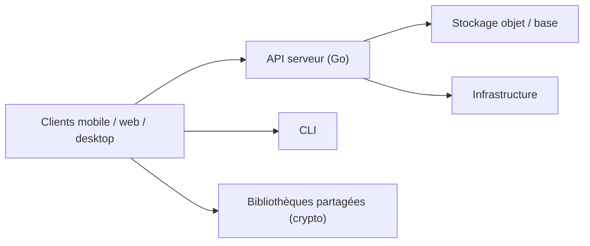

# ente-io/ente

> Monorepo d'une plateforme chiffrée de bout en bout : photos, authentificateur 2FA et coffre de documents.

## Le problème
Stocker photos, codes 2FA et documents dans le cloud oblige à faire confiance au fournisseur.

## Ce que ça fait vraiment
Trois applications (Photos, Auth, Locker) sur un serveur commun écrit en Go, avec clients iOS, Android, web, desktop et CLI. Le chiffrement est de bout en bout, le code a été audité par Cure53, Symbolic Software et Fallible selon le README. Photos propose reconnaissance faciale et recherche sémantique ; Auth est gratuit ; Locker est gratuit jusqu'à 100 éléments. Le serveur peut être auto-hébergé.

## Comment c'est branché

## Essayer
Aucune commande dans le README : voir ente.com et la documentation pour l'auto-hébergement.

## Coût et pièges
Photos est payant (10 Go gratuits). L'auto-hébergement suppose de gérer serveur et stockage. Licence AGPL-3.0.

## Ce que ce n'est pas
Pas un simple outil : c'est une plateforme complète, et le service géré est une offre commerciale. Voir aussi `ente/ente`, même README.

## Alternatives
Aucune alternative nommée dans le README (il cite Apple, Google Photos et Authy comme produits à remplacer).

## Pour toi
À surveiller : intéressant si tu veux héberger tes photos et 2FA en chiffré, mais hors de ton cœur de métier data / MLOps.

