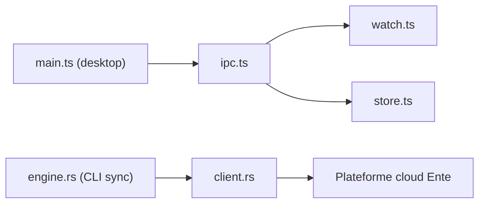

# ente/ente

> Apparent duplicate of `ente-io/ente`: monorepo of end-to-end encrypted photos, 2FA and vault.

## The problem
Same problem as `ente-io/ente`: storing photos, 2FA codes and documents without trusting the provider.

## What it actually does
The README is identical to that of `ente-io/ente`. The architecture described from the code adds details: desktop client main process with IPC, file watching and auto-update; the CLI's sync engine in Rust; staff administration (storage bonuses). The Ensu (chat) and Cast clients exist in the tree but their flows are not established.

## How it is wired

## Trying it
No command in the README: see ente.com.

## Cost and gotchas
Photos is paid (10 GB free), Locker limited to 100 items on the free tier. AGPL-3.0 license. The catalog lists this repository and `ente-io/ente` separately.

## What it is not
Not a distinct repository by its content: probably a rename or mirror of `ente-io/ente`. Not verified.

## Alternatives
No alternative named in the README.

## For you
Worth watching like `ente-io/ente`, and to deduplicate in your catalog: outside your data / MLOps core.
