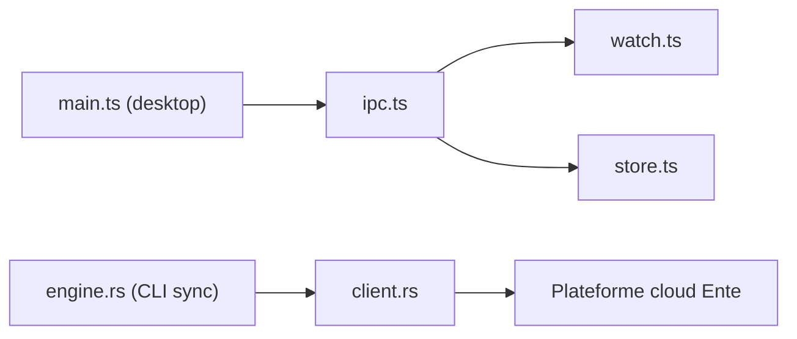

# ente/ente

> Doublon apparent de `ente-io/ente` : monorepo de photos, 2FA et coffre chiffrés de bout en bout.

## Le problème
Même problème que `ente-io/ente` : stocker photos, codes 2FA et documents sans faire confiance au fournisseur.

## Ce que ça fait vraiment
Le README est identique à celui de `ente-io/ente`. L'architecture décrite d'après le code ajoute des détails : processus principal du client desktop avec IPC, surveillance de fichiers et mise à jour automatique ; moteur de synchronisation du CLI en Rust ; administration du personnel (bonus de stockage). Les clients Ensu (chat) et Cast existent dans l'arbre mais leurs flux ne sont pas établis.

## Comment c'est branché

## Essayer
Aucune commande dans le README : voir ente.com.

## Coût et pièges
Photos payant (10 Go gratuits), Locker limité à 100 éléments en gratuit. Licence AGPL-3.0. Le catalogue liste ce dépôt et `ente-io/ente` séparément.

## Ce que ce n'est pas
Pas un dépôt distinct par son contenu : probablement un renommage ou miroir de `ente-io/ente`. Non vérifié.

## Alternatives
Aucune alternative nommée dans le README.

## Pour toi
À surveiller comme `ente-io/ente`, et à dédoublonner dans ton catalogue : hors cœur de métier data / MLOps.

