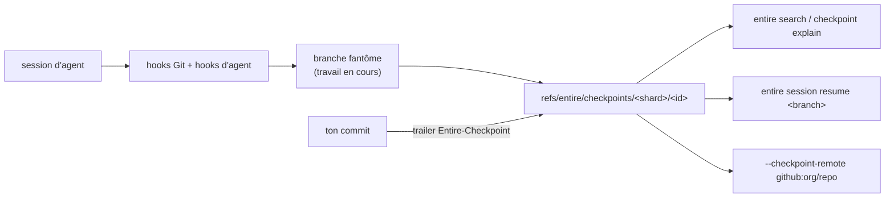

# entireio/cli

> Captures coding agent sessions and indexes them alongside Git commits, without polluting them.

## The problem
After a commit written by an agent, only the diff remains: the prompt, the reasoning and the
files touched are gone, and resuming a session abandoned by a colleague is impossible.

## What it actually does
`entire enable` installs Git hooks and agent hooks that record the session as it goes
on an ephemeral shadow branch. On commit, this work is condensed into a permanent checkpoint
stored as an independent Git ref `refs/entire/checkpoints/<shard>/<id>`, whose tree *is* the
checkpoint (`metadata.json`, per-session transcripts, sub-agent records); the commit
carries an `Entire-Checkpoint:` trailer. No commit is created on the active branch. Since the refs are
independent, two concurrent sessions never fight over a branch tip, and a checkpoint
written on another machine is fetched on demand. Session identifiers are those supplied
by the agent itself, never forged by Entire.

## How it is wired


## Trying it
```bash
brew install --cask entireio/tap/entire
# ou : curl -fsSL https://entire.io/install.sh | bash
cd your-project && entire enable --agent claude-code
entire status
entire session resume <branch>
git for-each-ref refs/entire/checkpoints
entire checkpoint list
entire checkpoint explain <id>
ENTIRE_TOKEN_STORE=file entire login
entire disable
```

## Cost and gotchas
`entire login` opens a browser and stores tokens in the OS keychain; in CI or headless
you need `--device`, `ENTIRE_TOKEN_STORE=file` or to inject `ENTIRE_TOKEN` on each call. Anonymous
analytics are on by default (`--telemetry=false` to turn off). A remote control plane
(orgs, projects, clusters) exists, and its pricing is not documented in the README.

## What it is not
Not a purely local tool: the `cluster`, `org`, `project`, `repo` commands talk to a hosted
service, and the CLI derives its endpoint from the token. Not a replacement for code review. The
`review`, `investigate`, `blame`, `why`, `import` commands are experimental, hidden in stable.

## Alternatives
No alternative named in the README.

## For you
Storing in Git refs is the right idea; the SaaS control plane is the point to settle beforehand.
