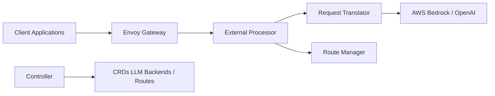

# envoyproxy/ai-gateway

> Envoy control plane that exposes a single OpenAI-compatible API to hosted models, self-hosted models and MCP servers, for platform teams.

## The problem
Each application calls its model provider with its own keys, quotas and fallbacks; platform teams have no central control point.

## What it actually does
An OpenAI-compatible API in front of several providers (Bedrock and OpenAI cited by the diagram). Credentials, routing, quotas, failover and usage attribution are centralized, enforced by Envoy and Envoy Gateway. Two-tier model: an ingress gateway (authentication, routing, global limits) and a gateway to the self-hosted model cluster with endpoint selection. Renamed Agent Router; CRDs and the `aigw` CLI unchanged.

## How it is wired


## Trying it
```bash
OPENAI_API_KEY=sk-your-key aigw run
# puis pointer un client OpenAI-compatible sur http://localhost:1975/v1
```

## Cost and gotchas
Local mode only requires a provider key; the full deployment assumes Kubernetes and Envoy Gateway. Model calls are still billed by the providers. 313 open issues.

## What it is not
Not a simple desktop proxy: the relevant use is on Kubernetes. API v1alpha1 according to the diagram, so subject to change. It is not a model evaluation tool.

## Alternatives
No alternative named in the README.

## For you
Worth watching: relevant if you operate a multi-model inference platform on Kubernetes; for individual use, it is overkill.
