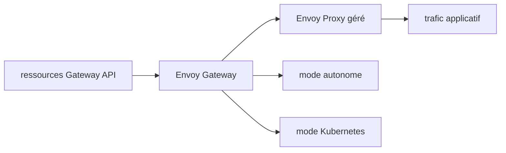

# envoyproxy/gateway

> Management of Envoy Proxy as an application gateway, standalone or on Kubernetes.

## The problem
Configuring Envoy by hand to serve as an application gateway is tedious and barely declarative.

## What it actually does
Dynamically provisions and configures managed Envoy Proxies from Gateway API resources.
The README describes nothing else: it points to the introductory blog post, the goals, the quickstart,
the roadmap and the compatibility matrix. Minimal sheet, insufficient material.

## How it is wired

## Trying it
No command documented in the README: it points to the external quickstart.

## Cost and gotchas
Free. Nothing is specified about prerequisites or the Envoy version: the compatibility matrix
is external. The license is not declared in the README.

## What it is not
It is not the Gateway API specification: it is an implementation that consumes it.
It is not a proxy: it is Envoy's control plane. The README is not enough to decide:
you have to read the goals and the roadmap.

## Alternatives
None named in the README.

## For you
Only worth a look if you operate a Kubernetes gateway; otherwise nothing to gain from it.
