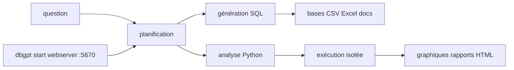

# eosphoros-ai/DB-GPT

> Agentic data assistant: it connects to your databases, writes SQL and produces reports.

## The problem
Answering a business question requires finding the table, writing the SQL, cleaning, plotting a chart.
Each step is simple, the chain is long, and it starts over with every new question.

## What it actually does
Connects to databases, CSV/Excel files, warehouses and knowledge bases in a single workspace.
Plans the task, writes SQL and Python, executes step by step and produces charts, dashboards, HTML reports.
Code execution happens in isolated environments, with reusable "skills" per domain.
The web server listens on `http://localhost:5670` after a setup wizard on first launch.

## How it is wired


## Trying it
```bash
uv pip install dbgpt-app
dbgpt start
```
One-line installer (read it before running it, the README gives the `-o install.sh` + `less` variant):
`curl -fsSL https://raw.githubusercontent.com/eosphoros-ai/DB-GPT/main/scripts/install/install.sh | OPENAI_API_KEY=sk-xxx bash -s -- --profile openai`.

## Cost and gotchas
Python 3.10+ and an API key from OpenAI, Moonshot (Kimi) or MiniMax depending on the chosen profile.
The install path put forward is a `curl | bash`: read the script, the README itself invites you to.

## What it is not
Not a rigid BI tool: it generates reports, it does not replace a governed semantic model.
Not risk-free on your databases: it writes and executes SQL autonomously, to be bounded by read-only permissions.
Not fully local by default: private mode (local models, desensitization) is a separate configuration.

## Alternatives
None named in the README.

## For you
Test on a read-only replica: the idea is right, the SQL autonomy needs a safeguard.
