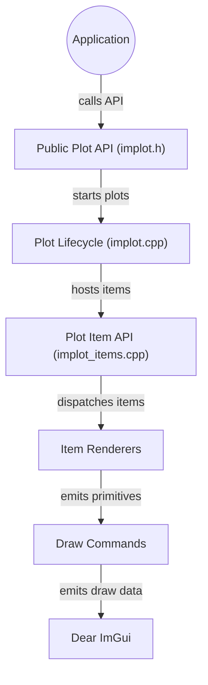

# epezent/implot

> Immediate-mode interactive plotting C++ library for Dear ImGui, to visualize data in real time.

## The problem
Dear ImGui can barely plot curves: visualizing an application's live data requires coding your own rendering.

## What it actually does
You open a plot with `ImPlot::BeginPlot()`, call `PlotLine`, `PlotBars`, `PlotScatter` and others, then `EndPlot()`. It offers lines, bars, histograms, heatmaps, pie charts, logarithmic and time axes, subplots, zoom, selection and colormaps. It does not export images and has no dependency other than ImGui.

## How it is wired


## Trying it
```bash
git clone https://github.com/Microsoft/vcpkg.git
cd vcpkg
./bootstrap-vcpkg.sh
./vcpkg integrate install
./vcpkg install implot
```

## Cost and gotchas
Free, MIT license. Dear ImGui uses 16-bit indices by default: for large heatmaps, you must enable 32-bit indices in `imconfig.h`. Millions of points do not stay smooth.

## What it is not
It is not a publication-quality plotting library: the README discourages export and points to MATLAB or matplotlib. It provides no analysis tools, only queries on ranges.

## Alternatives
The README mentions matplotlib and MATLAB for publication graphics, and ImPlot3D for 3D.

## For you
Ignore unless you are writing a C++ application with ImGui; for data analysis, matplotlib remains the tool of your trade.
