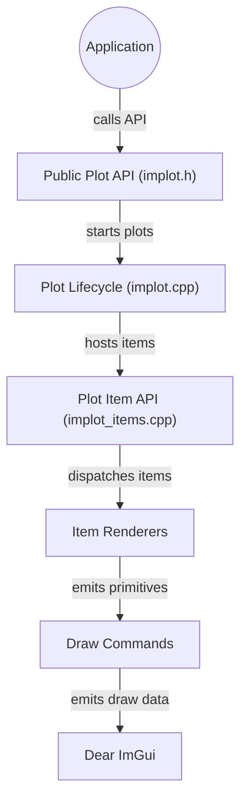

# epezent/implot

> Bibliothèque C++ de graphiques interactifs en mode immédiat pour Dear ImGui, pour visualiser des données en temps réel.

## Le problème
Dear ImGui sait peu tracer de courbes : visualiser des données d'une application en direct demande de coder son propre rendu.

## Ce que ça fait vraiment
On ouvre un graphe avec `ImPlot::BeginPlot()`, on appelle `PlotLine`, `PlotBars`, `PlotScatter` et d'autres, puis `EndPlot()`. Elle propose courbes, barres, histogrammes, cartes de chaleur, camemberts, axes logarithmiques et temporels, sous-graphes, zoom, sélection et colormaps. Elle n'exporte pas d'images et n'a pas de dépendance autre que ImGui.

## Comment c'est branché


## Essayer
```bash
git clone https://github.com/Microsoft/vcpkg.git
cd vcpkg
./bootstrap-vcpkg.sh
./vcpkg integrate install
./vcpkg install implot
```

## Coût et pièges
Gratuit, licence MIT. Dear ImGui utilise par défaut des indices 16 bits : sur de grandes cartes de chaleur, il faut activer les indices 32 bits dans `imconfig.h`. Les millions de points ne restent pas fluides.

## Ce que ce n'est pas
Ce n'est pas une bibliothèque de graphiques pour publications : le README déconseille l'export et renvoie vers MATLAB ou matplotlib. Elle ne fournit pas d'outils d'analyse, seulement des requêtes sur des plages.

## Alternatives
Le README cite matplotlib et MATLAB pour les graphiques de publication, et ImPlot3D pour la 3D.

## Pour toi
À ignorer sauf si tu écris une application C++ avec ImGui ; pour l'analyse de données, matplotlib reste l'outil de ton métier.

